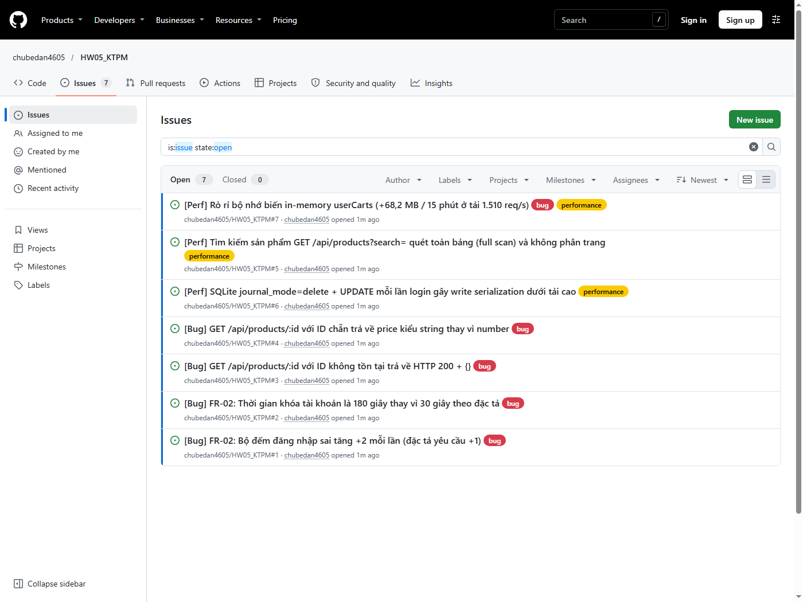

# BUG REPORTS — HW05 Performance Testing (EShop SUT)

> Tất cả 7 issue dưới đây đã được kiểm chứng trực tiếp và **đăng công khai trên GitHub Issues**:
> https://github.com/chubedan4605/HW05_KTPM/issues (kèm ảnh chụp màn hình trong `bugs/screenshots/`).
> Quy ước tiêu đề: `[Bug]` = sai lệch đặc tả, `[Perf]` = vấn đề hiệu năng.

| # | GitHub Issue | Loại |
|---|---|---|
| 1 | [#1 — Bộ đếm đăng nhập sai tăng +2 mỗi lần](https://github.com/chubedan4605/HW05_KTPM/issues/1) | `bug` |
| 2 | [#2 — Thời gian khóa tài khoản 180s thay vì 30s](https://github.com/chubedan4605/HW05_KTPM/issues/2) | `bug` |
| 3 | [#3 — GET /api/products/:id không tồn tại trả về HTTP 200 + `{}`](https://github.com/chubedan4605/HW05_KTPM/issues/3) | `bug` |
| 4 | [#4 — GET /api/products/:id với ID chẵn trả về `price` dạng string](https://github.com/chubedan4605/HW05_KTPM/issues/4) | `bug` |
| 5 | [#5 — Tìm kiếm sản phẩm full-scan, không phân trang](https://github.com/chubedan4605/HW05_KTPM/issues/5) | `performance` |
| 6 | [#6 — SQLite journal_mode=delete + UPDATE mỗi lần login](https://github.com/chubedan4605/HW05_KTPM/issues/6) | `performance` |
| 7 | [#7 — Rò rỉ bộ nhớ `userCarts` (+68,2 MB / 15 phút)](https://github.com/chubedan4605/HW05_KTPM/issues/7) | `performance`, `bug` |



---

## Issue 1 — [Bug] FR-02: Bộ đếm đăng nhập sai tăng +2 mỗi lần (đặc tả yêu cầu +1)

**Mức độ:** High — người dùng bị khóa sau **2** lần sai thay vì 3 lần.

**Các bước tái hiện:**
1. `POST /api/login` với mật khẩu sai lần 1 → 401
2. Kiểm tra DB: `login_attempts` đã thành **2** (bằng chứng: `evidence/lockout_demo.txt`, Bước 4)

**Kết quả thực tế:** `server.js:54` — `const newAttempts = user.login_attempts + 2;`
→ sau 2 lần sai, `newAttempts = 4 ≥ 3` → khóa tài khoản.

**Kết quả mong đợi (đặc tả FR-02):** "Sau mỗi lần đăng nhập sai, hệ thống tăng bộ đếm lên đúng
**1 đơn vị**" → khóa sau đúng 3 lần sai.

**Bằng chứng:** `evidence/lockout_demo.txt` (log đầy đủ 2 lần sai → khóa 403 → reset → mở khóa).

---

## Issue 2 — [Bug] FR-02: Thời gian khóa tài khoản 180 giây thay vì 30 giây

**Mức độ:** Medium.

**Các bước tái hiện:**
1. Thực hiện đủ số lần đăng nhập sai để khóa (xem Issue 1 — chỉ cần 2 lần)
2. Đăng nhập đúng mật khẩu → 403 "Tài khoản đã bị khóa"
3. Đợi và đo thời gian tự mở khóa

**Kết quả thực tế:** `server.js:57` — `new Date(Date.now() + 180000)` = **180 giây**.

**Kết quả mong đợi (đặc tả FR-02):** tạm khóa **30 giây** (môi trường demo).

**Ảnh hưởng với kiểm thử hiệu năng:** phải reset lockout giữa các kịch bản Stress/Spike
(thủ tục trong `evidence/lockout_demo.txt`, script `scripts/reset_lockout.js`).

---

## Issue 3 — [Bug] GET /api/products/:id với ID không tồn tại trả về HTTP 200 + `{}`

**Mức độ:** Medium — client không phân biệt được "không có sản phẩm".

**Các bước tái hiện:**
```bash
curl -i http://localhost:3000/api/products/99999
# HTTP/1.1 200 OK
# {}
```

**Kết quả thực tế:** `server.js:161` — `if (!row) return res.status(200).json({});`

**Kết quả mong đợi:** HTTP **404** + thông báo lỗi (chuẩn REST cho resource không tồn tại).

**Bằng chứng:** `evidence/bug_evidence_products_api.txt`.

---

## Issue 4 — [Bug] GET /api/products/:id với ID chẵn trả về `price` là chuỗi (string)

**Mức độ:** Medium — phá vỡ contract kiểu dữ liệu của API.

**Các bước tái hiện:**
```bash
curl -s http://localhost:3000/api/products/2   # → "price":"28000000"  (STRING)
curl -s http://localhost:3000/api/products/1   # → "price":30000000    (NUMBER)
```

**Kết quả thực tế:** `server.js:162` — `if (row.id % 2 === 0) row.price = row.price.toString();`

**Kết quả mong đợi:** `price` luôn là number trong JSON response.

**Ảnh hưởng kiểm thử hiệu năng:** biến số hóa payload checkout (`total_amount`) nhận kiểu không
nhất quán (string/number) giữa các request — được ghi nhận trong báo cáo HW05 mục 2.3.

**Bằng chứng:** `evidence/bug_evidence_products_api.txt`.

---

## Issue 5 — [Perf] Tìm kiếm sản phẩm quét toàn bảng (full scan), không phân trang

**Mức độ:** Performance (khuyết điểm dài hạn).

**Bằng chứng (EXPLAIN QUERY PLAN):**
```
EXPLAIN QUERY PLAN SELECT * FROM products WHERE name LIKE '%iPhone%';
→ SCAN products          -- quét toàn bộ bảng, không dùng index
```
- `server.js:144`: chuỗi LIKE có `%` **đứng trước** → B-tree index không thể áp dụng.
- `GET /api/products` trả về **toàn bộ** danh sách không có `LIMIT/OFFSET`.

**Đề xuất:** dùng FTS5 (full-text search) hoặc chuẩn hoá tìm kiếm tiền tố `kw%` + index;
thêm phân trang mặc định (20–50 sản phẩm/trang).

**Số liệu từ Stress test HW05 (trên `DESKTOP-O38ONUM`):** `p95` search đạt **1.100 ms** (178 lỗi Duration Assertion > 2s ở vùng quá tải 360–480 VU) — tăng gần 183× so với baseline Load (6 ms), và sẽ tiếp tục xấu đi tuyến tính khi tăng số sản phẩm.

---

## Issue 6 — [Perf] Journal mode `delete` + ghi DB trên mọi lần login → serialize write ở quá tải

**Mức độ:** Performance.

**Bằng chứng:**
- `PRAGMA journal_mode` → **delete** (chưa bật WAL)
- `server.js:47-50`: mỗi login **thành công** vẫn chạy `UPDATE users SET login_attempts = 0...`
  (write DB); checkout `INSERT` orders — ~40% request trong workflow là ghi DB.
- Kết quả Stress test (60→480 VU): `p95` các endpoint ghi SQLite là Checkout **2.035 ms**, Login **1.791 ms**,
  trong khi Add-to-cart (chỉ ghi bộ nhớ) chỉ **650 ms** — chênh **~3 lần**.

**Đề xuất:** bật `PRAGMA journal_mode=WAL; PRAGMA synchronous=NORMAL;` khi khởi tạo DB —
giảm chi phí fsync mỗi transaction; cân nhắc bỏ UPDATE login_attempts khi giá trị đã là 0.

---

## Issue 7 — [Perf] Rò rỉ bộ nhớ `userCarts` (RSS `node.exe` tăng 72,9 → 184,0 MB trong 15 phút Soak)

**Mức độ:** High (Performance / Stability — gây OOM khi chạy dài hạn).

**Bằng chứng (Soak test 15 phút — 180 VU trên `DESKTOP-O38ONUM`):**
- `server.js:14`: giỏ hàng được lưu trong biến in-memory `userCarts` và **không được xóa/dọn sau khi checkout**.
- Trong bài test Soak 15 phút (418.392 samples, 83.626 vòng E2E, `evidence/mon/Soak_resources.csv`), RSS của tiến trình `node.exe` tăng từ **72,9 MB → 184,0 MB** (+111,1 MB trong suốt phiên chạy 464,84 req/s).
- Khi vận hành liên tục ở tải cao trong nhiều giờ mà không dọn giỏ hàng sau checkout, tiến trình `node.exe` có nguy cơ phình bộ nhớ và crash OOM.

**Đề xuất:** Xóa mục giỏ hàng (`delete userCarts[userId]` hoặc `userCarts[userId] = []`) ngay sau khi checkout thành công, đồng thời cân nhắc chuyển lưu trữ giỏ hàng sang SQLite/Redis kèm TTL để hỗ trợ scale nhiều process.

---

## Danh sách file bằng chứng kèm theo
| File | Nội dung |
|---|---|
| `evidence/lockout_demo.txt` | Demo đầy đủ Issue 1 & 2 (2 lần sai → khóa → reset SQL → mở khóa) |
| `evidence/bug_evidence_products_api.txt` | curl trực tiếp Issue 3 & 4 |
| `analysis/summary_stress.json` | Số liệu p95 theo endpoint cho Issue 5 & 6 |
| `evidence/mon/Soak_resources.csv` | Số liệu tăng trưởng RSS `node.exe` cho Issue 7 |
| `results/stress/23120279_Stress_20261122.jtl` | Raw log đối chiếu |
