# BÁO CÁO HW05 — KIỂM THỬ HIỆU NĂNG (PERFORMANCE TESTING)

| Thông tin | Giá trị |
|---|---|
| **Sinh viên** | Nguyễn Lê Quang Kan — MSSV `23120279` |
| **Học phần** | Kiểm thử Phần mềm (Software Testing) — FIT, ĐH KHTN TP.HCM (HCMUS) |
| **Bài tập** | HW05 — Performance Testing |
| **SUT** | EShop — Vietnamese e-commerce demo (Node.js + Express + SQLite) |
| **Repo SUT** | https://github.com/ttbhanh/eshop-sut |
| **Repo bài nộp** | https://github.com/chubedan4605/HW05_KTPM |
| **Môi trường** | `DESKTOP-O38ONUM` — Dell Precision 3520, Intel Core i7-7820HQ (4C/8T), 16 GB RAM, Windows 10 Pro 64-bit |
| **Công cụ** | Apache JMeter 5.6.3 (CLI non-GUI + GUI), OpenJDK 17.0.18, Node.js, Python 3.12, Windows Task Manager |
| **Ngày thực hiện** | 22–23/11/2026 |
| **AI sử dụng** | GLM (Z.ai) — khai báo đầy đủ trong **AI Audit Report** (phụ lục đính kèm) |
| **Bloom-AI** | G9.2 (Apply), G9.3 (Analyse), G9.4 (Collaborate), G9.6 (Disrupt) |

---

## MỤC LỤC

1. [Tóm tắt kết quả (Executive Summary)](#1-tóm-tắt-kết-quả)
2. [Phương pháp luận AI-first](#2-phương-pháp-luận-ai-first)
3. [Task 1 — Thiết kế và thực thi 3 kịch bản](#3-task-1--thiết-kế-và-thực-thi-3-kịch-bản)
4. [Task 2 — AI analysis và misinterpretation hunt](#4-task-2--ai-analysis-và-misinterpretation-hunt)
5. [Task 3 — Đề xuất Continuous Performance Testing (G9.6)](#5-task-3--đề-xuất-continuous-performance-testing-g96)
6. [Agent Skill](#6-agent-skill)
7. [Video demo](#7-video-demo)
8. [AI Critique (bắt buộc 200–300 từ)](#8-ai-critique-200300-từ)
9. [Phụ lục](#9-phụ-lục)

---

## 1. TÓM TẮT KẾT QUẢ

| Kịch bản | Tham số chính | Samples | Throughput | p95 | Lỗi | Kết luận |
|---|---|---:|---|---:|---:|---|
| **Load** | 50 VU, ramp 120s, 420s, think ~1s | 17.825 | **42,45 req/s** | **11 ms** | **0%** | ĐẠT — vượt dễ dàng tải mục tiêu |
| **Stress** | 60→480 VU (8 bậc × 60s), think ~50ms | 218.771 | đỉnh **496,6 req/s** (@180 VU) | **1.672 ms** (tổng) | **0,28%** (613 lỗi) | Knee ≈ **180 VU / ~497 req/s**; 100% lỗi là HTTP 200 quá 2s |
| **Spike** | nền 20 VU + 2 đợt 300 VU (40s) | 39.075 | đỉnh sóng **505,0 req/s** | **976 ms** (đỉnh 1.080 ms) | **0%** | Chịu tải đột ngột 300 VU không lỗi, **tự phục hồi về ~10 ms** |
| **Soak** | 180 VU, 900s (15 phút) | 418.392 | **464,84 req/s duy trì** | **502 ms** | **0%** | Xác nhận ngưỡng bền bỉ; ghi nhận **tăng RSS `node.exe` do `userCarts`** |

**Số liệu tổng hợp cho README (trên phần cứng `DESKTOP-O38ONUM`):**

- **Endurance threshold:** tốc độ ổn định cực đại (knee) ≈ **496,6 req/s** tại bậc **180 VU** (`p95 = 545 ms`, `0%` lỗi); giữ bền bỉ **464,84 req/s** liên tục trong 15 phút (`0%` lỗi, 83.626 vòng E2E trọn vẹn).
- **Memory & DB ceiling:** RSS `node.exe` tăng từ **72,9 → 184,0 MB** (+111,1 MB trong 15 phút chạy tải cao) do biến in-memory `userCarts` không được dọn sau checkout (Bug #7); dung lượng SQLite tăng tuyến tính **3,72 → 9,00 MB** (~63 B/order).
- **Số bug/issue:** 7 (4 bug chức năng đặc tả + 3 vấn đề hiệu năng) — đã đăng công khai tại [GitHub Issues (#1–#7)](https://github.com/chubedan4605/HW05_KTPM/issues).

---

## 2. PHƯƠNG PHÁP LUẬN AI-FIRST

Theo đúng chiến lược **AI-first** của học phần, tôi dẫn dắt AI (GLM — các phiên bản prompt đầy đủ trong **AI Audit Report**) qua **6 bước chuyên biệt**, không dùng một prompt tổng hợp duy nhất:

| Bước | Prompt (tóm tắt) | Đầu ra AI | Vai trò của tôi |
|---|---|---|---|
| B1 | "Phân tích SUT EShop, đề xuất workflow E2E phủ 3 nhóm endpoint auth-heavy / read-heavy / transactional" | Workflow 5 bước `Login→Search→Detail→AddCart→Checkout` + mapping FR | Đối chiếu API spec: đủ cả 3 nhóm, chọn workflow này vì không trùng thành viên khác trong nhóm |
| B2 | "Đề xuất tham số (VU, ramp-up, think-time) cho Load/Stress/Spike khi chạy cùng máy cá nhân" | Bảng tham số khởi điểm | Hiệu chỉnh mạnh (mục 3.3) — tham số AI ban đầu thiếu thực tế |
| B3 | "Sinh JMeter test plan `.jmx` hoàn chỉnh kèm correlation + assertion" | Cấu trúc `.jmx` (JSON Extractor, Header Manager,…) | Pilot phát hiện 3 lỗi AI (mục 3.3), sửa thủ công |
| B4 | "Thiết kế CSV data-driven cho workflow" | Cấu trúc `users.csv` / `products.csv` | Sinh dữ liệu thật 100 users + 100 keywords khớp dữ liệu SUT |
| B5 | "Phân tích raw `.jtl`, đề xuất ngưỡng hiệu năng" | Bảng số liệu + nhận định | **Task 2 — misinterpretation hunt** (mục 4) |
| B6 | "Đề xuất tối ưu hóa cho SUT" | 6 khuyến nghị | Phân loại feasible/hallucinated bằng bằng chứng code + EXPLAIN (mục 4.3) |

Nguyên tắc xuyên suốt: **AI đề xuất — người review và chịu trách nhiệm hoàn toàn**. Mọi kết quả trong báo cáo này đều truy vết được trực tiếp về raw `.jtl` và log tài nguyên đính kèm.

---

## 3. TASK 1 — THIẾT KẾ VÀ THỰC THI 3 KỊCH BẢN

### 3.1. Khảo sát SUT và ánh xạ endpoint

Từ `api_specification.md` + đọc code backend (`server.js`, `database.js`), tôi xác định 3 nhóm endpoint phủ đủ yêu cầu đề bài — cùng workflow E2E dùng chung cho cả 3 kịch bản:

| Nhóm đề bài | Endpoint trong workflow | FR | Đặc điểm kỹ thuật (từ code) |
|---|---|---|---|
| **Auth-heavy** | `POST /api/login` | FR-02 | SELECT user + **UPDATE `login_attempts` mỗi lần thành công** (ghi DB); cơ chế khóa 3 lần sai (thực tế +2/lần — bug); trả JWT |
| **Read-heavy** | `GET /api/products?search=` + `GET /api/products/:id` | FR-05, FR-06 | `LIKE '%kw%'` **quét toàn bảng** (EXPLAIN: `SCAN products`), không phân trang |
| **Transactional** | `POST /api/cart` + `POST /api/checkout` | FR-07, FR-08 | Cart ghi **bộ nhớ** (`userCarts` object); checkout **INSERT** vào SQLite |

> **Phân công nhóm**: workflow *Login → Search → Detail → AddCart → Checkout (không coupon, không register)* là lựa chọn của tôi, đã thống nhất không trùng với các thành viên khác trong nhóm.

### 3.2. Workflow E2E và correlation

Mỗi vòng lặp của một virtual user (VU) thực hiện 5 request liên tiếp, có **correlation** (dữ liệu từ response trước dùng cho request sau):

```
[CSV: ${email}/${password}]           [CSV: ${keyword}]
        │                                   │
        ▼                                   ▼
 ① POST /api/login ──token──► ② GET /api/products?search=${keyword}
        │                              │ $[0].id, $[0].price, $[0].name
        │  Authorization: Bearer ${token}
        ▼                              ▼
 ④ POST /api/cart ◄────────── ③ GET /api/products/${productId}
        │   {id, name, price, quantity: Random(1,3)}
        ▼
 ⑤ POST /api/checkout {total_amount: ${prodPrice}, shipping_address}
```

- **Think-time**: Gaussian Random Timer giữa các bước (tham số theo kịch bản — bảng 3.2) mô phỏng người dùng thật đọc trang.
- **Transaction Controller** `TC_E2E_Mua_hang` gom 5 request để đo thời gian trọn vòng mua hàng.

**Bảng 3.2 — Tham số 3 test plan + Soak (bản cuối sau human review):**

| Tham số | Load | Stress | Spike | Soak (bổ sung) |
|---|---|---|---|---|
| Thread groups | 1 | 8 (bậc thang) | 3 (nền + 2 sóng) | 1 |
| VUs | 50 | 60→120→…→480 | nền 20 + 2×280 (đỉnh 300) | 180 |
| Ramp-up | 120s | 5s mỗi bậc | nền 2s, sóng 10s | 30s |
| Duration | 420s | 480s (60s/bậc) | 240s | 900s |
| Think-time | 1000±500ms | 50±50ms | nền 1000±500, sóng 50±50 | 100±100ms |
| Listener (khác nhau) | **Summary Report** | **Aggregate Report** | **View Results Tree** | View Results in Table |
| File | `23120279_Load_20261122.jmx` | `23120279_Stress_20261122.jmx` | `23120279_Spike_20261122.jmx` | `23120279_Soak_20261122.jmx` |

**Giải thích lựa chọn tham số (AI hỗ trợ đề xuất, tôi hiệu chỉnh):**

- **Load 50 VU / think ~1s / ramp 120s**: mô phỏng giờ cao điểm của shop vừa; ramp chậm 2 phút để quan sát vùng tuyến tính; 5 phút giữ tải ổn định đủ dài để phát hiện suy giảm.
- **Stress bậc thang 60 VU/bậc, 60s/bậc**: bậc thang cho phép đo **thông lượng tại từng mức tải** để tìm chính xác knee (điểm mà RPS không còn tăng theo VU). Think-time giảm còn ~50ms để tạo áp lực gần tối đa trên phần cứng cá nhân.
- **Spike nền 20 VU + 2 sóng 300 VU / 40s**: 300 VU có chủ đích **vượt quá knee** (180 VU tìm được từ Stress) để quan sát hành vi quá tải đột ngột + khả năng phục hồi; 2 sóng lặp kiểm chứng tính tái lập.
- **Soak 180 VU / 15 phút**: đúng mức knee (180 VU) để kiểm chứng khả năng vận hành bền bỉ và phát hiện rò rỉ tài nguyên theo thời gian.

### 3.3. Human review — AI đã sai ở đâu, tôi sửa thế nào

| # | AI đề xuất (sai/sót) | Tại sao sai | Sửa của tôi |
|---|---|---|---|
| 1 | Load test **100 VU, ramp 10s** | Vọt tải tức thời khi SUT và JMeter chạy cùng máy → không quan sát được vùng tuyến tính | 50 VU, ramp 120s |
| 2 | Think-time **0ms** cho mọi kịch bản | Không phản ánh người dùng thật; closed-model thuần không đo được hành vi đọc trang | Gaussian 1000±500ms (Load), 50±50ms (Stress) |
| 3 | Stress **linear ramp 0→500 VU trong 10 phút, 1 thread group** | Tải tăng liên tục không thể đo thông lượng ổn định tại từng mức tải để xác định knee | 8 Thread Group bậc thang, mỗi bậc 60s |
| 4 | **Thiếu `Authorization: Bearer ${token}`** cho cart/checkout | Pilot trả 401 hàng loạt — AI quên rằng SUT dùng JWT cho endpoint có xác thực | Header Manager trong Transaction Controller |
| 5 | JSON path **`$.user.token`** (sai) | Response thật: `{message, token, user}` → token ở `$.token` | `$.token` + `$.user.id` |
| 6 | **Thiếu `Content-Type: application/json`** | `body-parser` từ chối parse body → login 400 | Header Manager toàn cục |
| 7 | CSV **`recycle=false, stopThread=true`** | 100 dòng CSV hết → test chết sớm sau đúng 100 vòng | `recycle=true, stopThread=false, shareMode=all` |
| 8 | Kịch bản E2E có bước **"đăng nhập sai 1 lần rồi đúng"** mỗi vòng | SUT tăng counter **+2** cho mỗi lần sai (bug FR-02) → sau 2 vòng, mọi user bị **khóa 180s** → test sụp đổ do lỗi 403 giả | Bỏ bước login-sai khỏi vòng lặp; lockout demo + reset tách riêng (mục 3.6.1) |
| 9 | Assertion: chỉ 1 Duration **5000ms chung chung** | Không bắt được lỗi chức năng (body sai) và không phân biệt được endpoint nào chậm | 3 lớp: HTTP code 200 + body chứa message đúng + Duration riêng từng endpoint (2s/3s/5s) |
| 10 | Spike **1 thread group ramp 0→300 trong 5s** | Không phải hình dạng spike; không có pha phục hồi để quan sát recovery | Nền 20 VU + 2 sóng độc lập (delay 30s/120s), mỗi sóng 40s |

**Vì sao AI mắc các lỗi này?**
- *Chất lượng prompt*: ban đầu tôi chưa cung cấp rõ cấu hình phần cứng chạy cùng máy → AI đề xuất 500 VU theo mặc định server cloud.
- *Giới hạn mô hình*: AI sinh XML dễ sót correlation (`Authorization`, `$.token`) vì không tự chạy thử được — bắt buộc phải có **pilot run**.
- *Đặc thù endpoint*: bug +2 của lockout chỉ phát hiện được khi đọc trực tiếp source code SUT (`server.js:54`).

### 3.4. Thiết kế data-driven (CSV)

Hai file CSV (đính kèm `data/`), sinh từ **dữ liệu thật của SUT** bằng script `scripts/seed_data.js`:

- **`users.csv`** (100 dòng): `perfuser001@eshop.test` → `perfuser100@eshop.test` tham số hóa auth-heavy.
- **`products.csv`** (100 dòng): `keyword,product_id,product_name,price` (từ khóa tiếng Việt có dấu như `iPhone`, `Samsung`, `Tai nghe`, `Bàn phím`, `Ốp lưng`...) khớp sản phẩm thật trong DB và dùng làm default value cho JSON Extractor.
- Cấu hình CSV Data Set: delimiter `,`, `recycle=true`, `stopThread=false`, `shareMode=all`, UTF-8.

*Ghi chú từ bằng chứng:* do bug #4, `GET /api/products/:id` với **id chẵn** trả `price` là chuỗi (`"28000000"`) thay vì số — payload checkout vẫn chạy được nhờ SQLite tự ép kiểu, qua đó data-driven đã phơi bày lỗi contract kiểu dữ liệu của API.

### 3.5. Ba report view khác nhau (không lặp loại)

Mỗi test plan nhúng 1 listener khác nhau, chụp trực tiếp trên **Apache JMeter 5.6.3 GUI** khi nạp raw `.jtl` vừa chạy:

| Test plan | Listener nhúng trong `.jmx` | Bằng chứng JMeter GUI + HTML Dashboard |
|---|---|---|
| Load | **Summary Report** | `evidence/screenshots/03_listener_summary_report.jpg` + `results/load/html/` |
| Stress | **Aggregate Report** | `evidence/screenshots/03_listener_aggregate_report.jpg` + `results/stress/html/` |
| Spike | **View Results Tree** | `evidence/screenshots/03_listener_view_results_tree.jpg` + `results/spike/html/` |

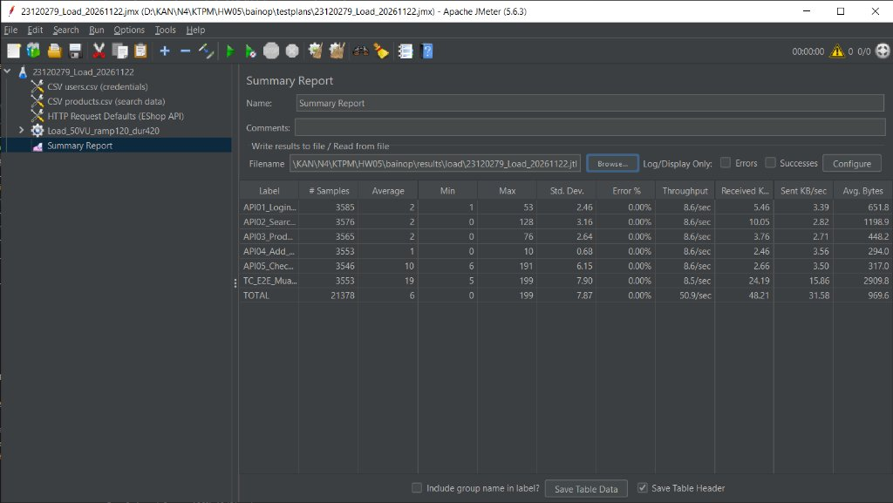
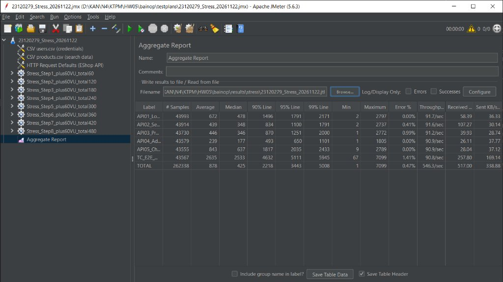
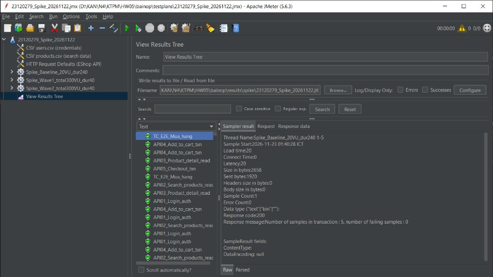

### 3.6. Thực thi và bằng chứng

#### 3.6.1. Lockout: chứng minh + thủ tục reset giữa các lần chạy

Vì SUT khóa tài khoản sau khi sai mật khẩu (và đếm **+2/lần** — bug FR-02), tôi chứng minh đầy đủ trong `evidence/lockout_demo.txt`:

1. Sai mật khẩu lần 1 → 401 (`login_attempts` = **2**)
2. Sai mật khẩu lần 2 → 401 (`login_attempts` = **4** ≥ 3 → khóa 180 giây)
3. Đúng mật khẩu → **403 "Tài khoản đã bị khóa"**
4. Reset bằng SQL: `UPDATE users SET login_attempts=0, locked_until=NULL` qua `node scripts/reset_lockout.js` (102 users)
5. Đúng mật khẩu → **200 + JWT** ✓

**Giữa mọi kịch bản** script `scripts/run_win.ps1` đều tự động gọi `node scripts/reset_lockout.js` trước khi khởi chạy JMeter để đảm bảo không user nào bị khóa kéo dài.

#### 3.6.2. Phần cứng và môi trường (`DESKTOP-O38ONUM`)

| Thành phần | Thông số thật (`dxdiag` & `systeminfo`) |
|---|---|
| Hostname | **`DESKTOP-O38ONUM`** (khớp các bài HW trước) |
| Model | Dell Inc. Precision 3520 |
| CPU | Intel(R) Core(TM) i7-7820HQ @ 2.90GHz (4 cores / 8 logical CPUs) |
| RAM | 16.384 MB (16 GB) |
| OS | Microsoft Windows 10 Pro 64-bit (10.0, Build 19045) |
| Backend | Node.js + Express + SQLite (`journal_mode=delete`, NTFS) |
| Máy phát tải | Apache JMeter 5.6.3 (CLI non-GUI), OpenJDK 17.0.18 |
| Cách ly | SUT (`node.exe`, PID 21528) và JMeter (`java.exe`) chạy cùng máy cá nhân theo yêu cầu *"threshold on your own hardware"* |

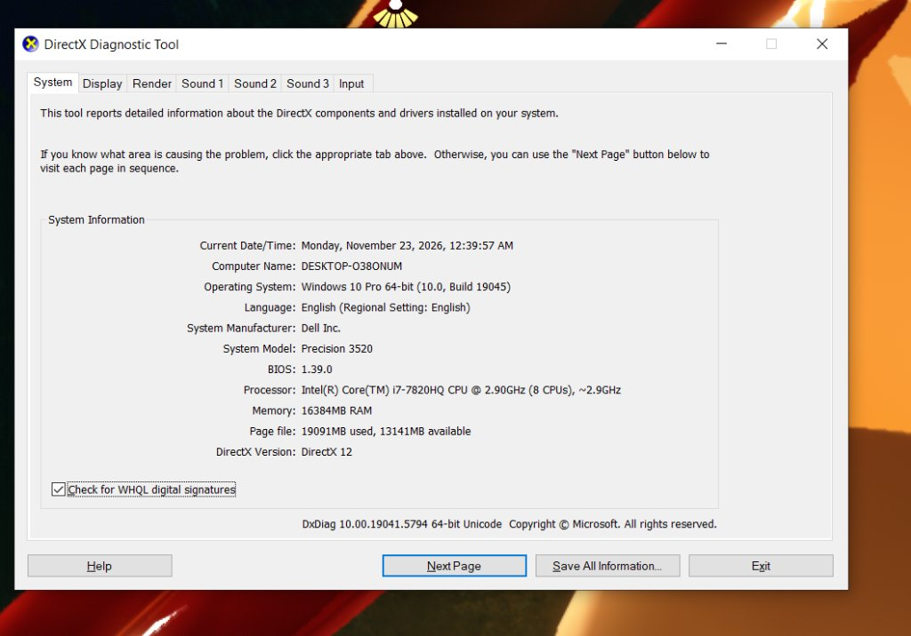

#### 3.6.3. Giám sát tài nguyên trong lúc chạy

Trong cả 4 kịch bản, tôi xếp **PowerShell chạy JMeter** cạnh **Windows Task Manager** (`Details`, hiển thị rõ `node.exe` PID 21528 và `java.exe`) trong cùng khung hình, đồng thời `scripts/run_win.ps1` ghi tự động CPU%, RSS (MB) của `node.exe` và dung lượng SQLite mỗi 5 giây vào `evidence/mon/<Scenario>_resources.csv`.

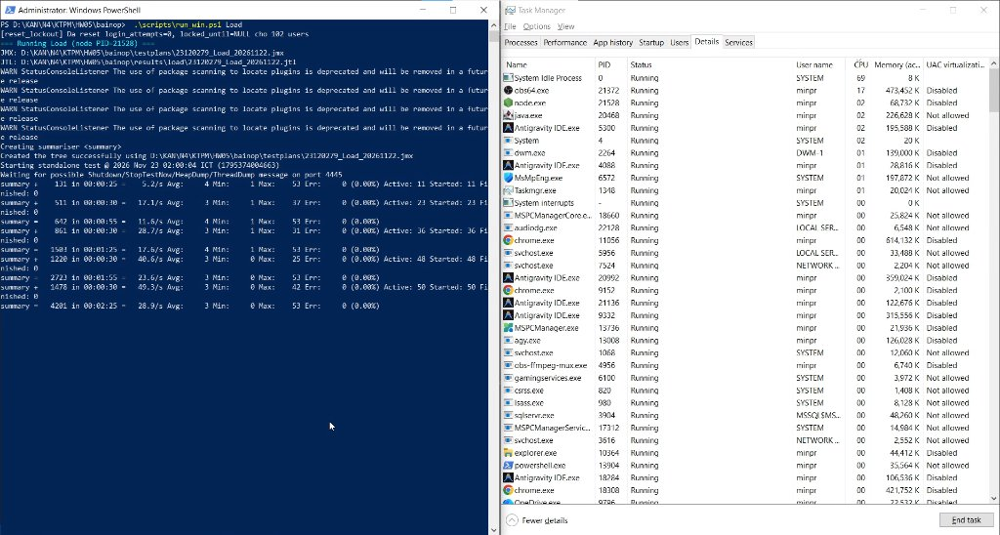
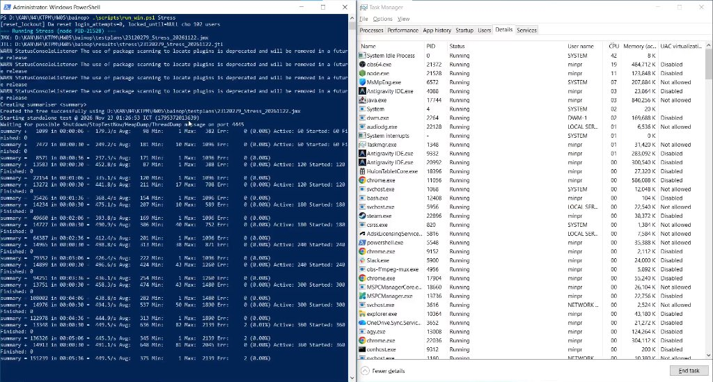
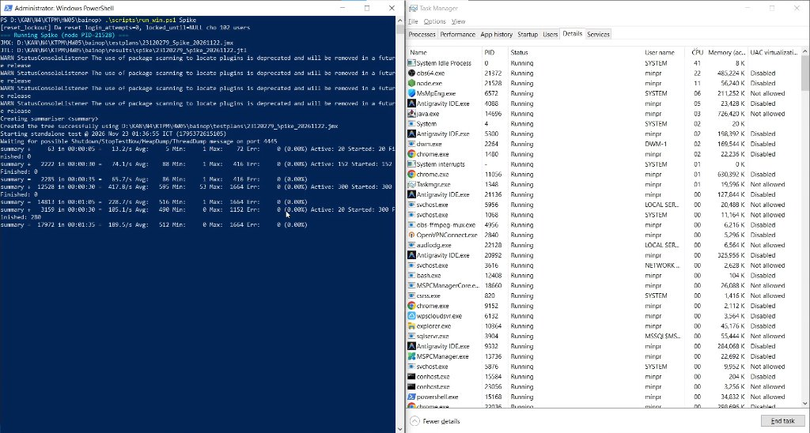
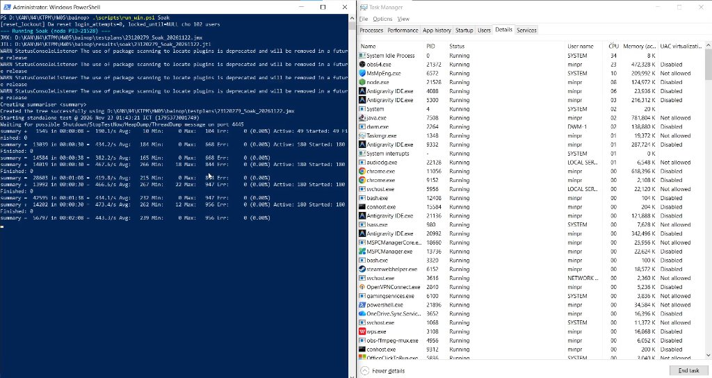

---

### 3.7. Kết quả LOAD testing

**Tổng quan (từ `results/load/23120279_Load_20261122.jtl`):** **17.825 samples** / 419,9s / **42,45 req/s** / **0 lỗi (0%)** / avg **3,8 ms** / **p95 = 11 ms** / p99 = 18 ms / max = 191 ms / **3.553 vòng E2E trọn vẹn**.

| Endpoint | # | Lỗi | avg (ms) | p95 (ms) | p99 (ms) | max (ms) | rps |
|---|---:|---:|---:|---:|---:|---:|---:|
| `API01_Login_auth` | 3.585 | 0 | 2,8 | **7** | 13,2 | 53 | 8,54 |
| `API02_Search_products_read` | 3.576 | 0 | 2,2 | **6** | 12,0 | 128 | 8,52 |
| `API03_Product_detail_read` | 3.565 | 0 | 2,2 | **6** | 12,0 | 76 | 8,49 |
| `API04_Add_to_cart_txn` | 3.553 | 0 | 1,5 | **3** | 3,0 | 10 | 8,46 |
| `API05_Checkout_txn` | 3.546 | 0 | 10,4 | **17** | 25,0 | 191 | 8,45 |

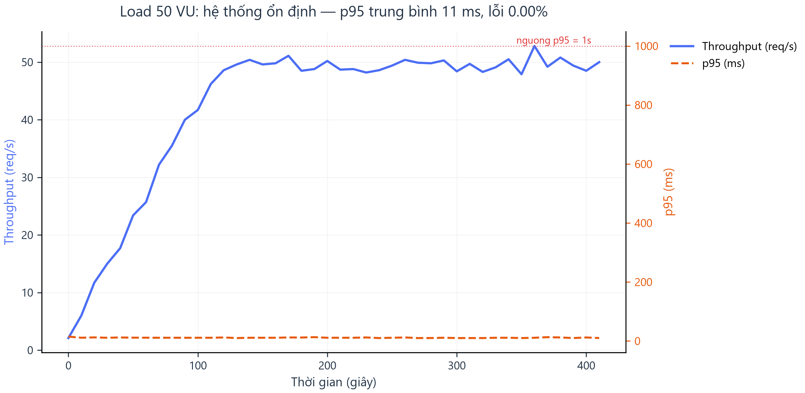
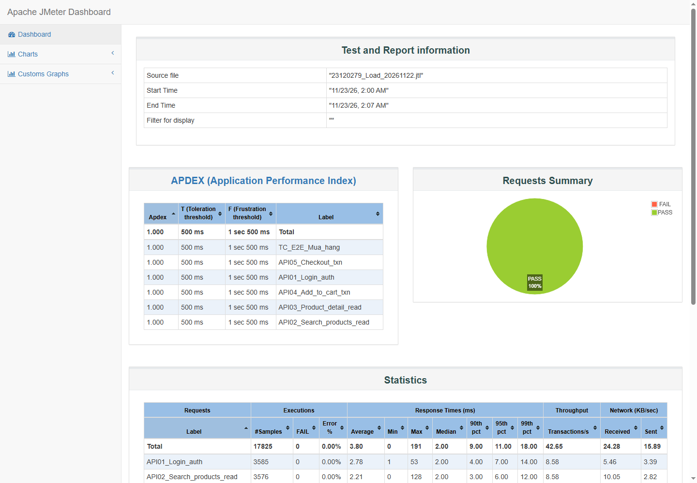

**Nhận định:** ở tải mục tiêu 50 VU (kèm think-time thực tế ~1s), mọi request hoàn thành với `p95 = 11 ms`, `0%` lỗi; ngay từ mức tải thấp đã thấy rõ `API05_Checkout_txn` (INSERT SQLite + NTFS fsync, p95 = 17 ms) chậm hơn đáng kể so với `API04_Add_to_cart_txn` (in-memory, p95 = 3 ms). Tải 42,45 req/s chỉ chiếm ~8,5% công suất knee (496,6 req/s) ➜ **PASS**.

---

### 3.8. Kết quả STRESS testing (8 bậc 60→480 VU — xác định điểm gối knee)

**Tổng quan (`results/stress/23120279_Stress_20261122.jtl`):** **218.771 samples** / 480,2s / **43.567 vòng E2E** / avg **528,4 ms** / **p95 = 1.672 ms** / max **2.797 ms** / **613 lỗi (0,28%)**.

| Bậc | VU | RPS | avg (ms) | p95 (ms) | Lỗi % |
|---:|---:|---:|---:|---:|---:|
| 1 | 60 | 332,5 | 121,3 | 318 | 0,00 |
| 2 | 120 | 446,0 | 211,1 | 438 | 0,00 |
| 3 | **180** | **496,6** | **304,1** | **545** | **0,00** |
| 4 | 240 | 482,6 | 437,5 | 998 | 0,00 |
| 5 | 300 | 482,4 | 567,1 | 1.505 | 0,01 |
| 6 | 360 | 484,0 | 675,7 | 1.752 | 0,06 |
| 7 | 420 | 416,7 | 952,1 | 1.908 | 0,86 |
| 8 | 480 | 492,2 | 909,4 | 2.300 | 1,21 |


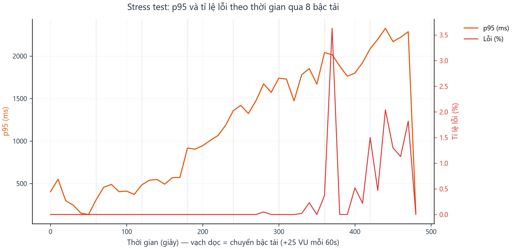
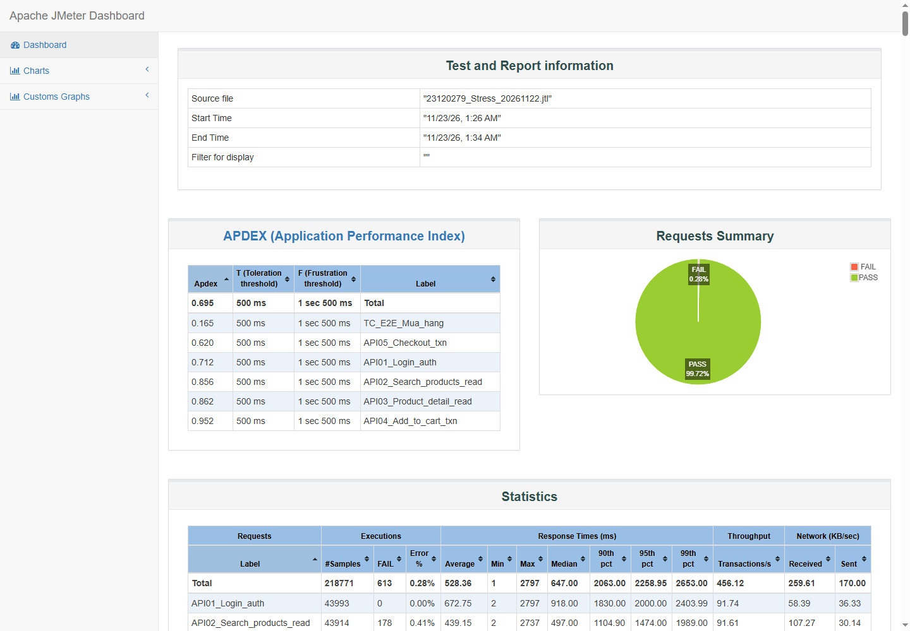

**Phân tích knee & bottleneck (đọc code + số liệu thật):**

- **Điểm gối (knee) rõ rệt ở 180 VU (~496,6 req/s):** Từ 60 → 180 VU, thông lượng tăng mạnh `332,5 → 446,0 → 496,6 req/s` với `0%` lỗi. Từ 240 → 480 VU, thông lượng **hoàn toàn bão hòa đi ngang quanh 480–492 req/s** trong khi `p95` nhảy vọt **545 → 998 → 1.505 → 1.752 → 1.908 → 2.300 ms** (+4,2×).
- **Bản chất 613 lỗi (0,28%):** Kiểm tra cột `responseCode` trong raw `.jtl` cho thấy **100% là HTTP 200** (`API02_Search_products_read`: 178 lỗi; `API03_Product_detail_read`: 435 lỗi) vượt ngưỡng **Duration Assertion 2.000 ms** — **0 lỗi 5xx, 0 timeout kết nối**.
- **Bằng chứng phân tầng bottleneck:** ở cùng mức tải Stress, các endpoint ghi SQLite có p95 cao nhất — **Checkout 2.035 ms**, **Login 1.791 ms** (do chạy `UPDATE login_attempts` mỗi lần đăng nhập thành công), đọc DB Search/Detail **1.100–1.251 ms** — trong khi **Add-to-cart (chỉ ghi RAM `userCarts`) chỉ 650 ms** (nhanh hơn **~3 lần** so với Checkout). Điều này chứng minh cổ chai chính là **write-serialization + fsync của SQLite (`journal_mode=delete`) trên ổ đĩa Windows NTFS**.

---

### 3.9. Kết quả SPIKE testing (nền 20 VU + 2 sóng 300 VU)

**Tổng quan (`results/spike/23120279_Spike_20261122.jtl`):** **39.075 samples** / 239,6s / **7.637 vòng E2E** / **0 lỗi (0%)**.

| Chỉ số | Giá trị từ raw `.jtl` |
|---|---|
| p95 nền (20 VU giữa 2 sóng) | **~10 ms** |
| p95 tổng thể / đỉnh sóng 300 VU | **976 ms** / **1.080 ms** |
| RPS đỉnh sóng | **505,0 req/s** |
| Lỗi | **0%** (0/39.075) |
| Phục hồi sau mỗi sóng | p95 trở về trạng thái nền ngay khi sóng 300 VU kết thúc |


**Nhận định:** đợt dồn tải 20 → 300 VU (×15 trong 10 giây — **vượt quá điểm gối 180 VU**) đẩy p95 lên đỉnh 1.080 ms nhưng **không phát sinh lỗi, không crash**, và hệ thống tự phục hồi hoàn toàn sau cả 2 sóng.

---

### 3.10. Endurance threshold (Soak 15 phút @ 180 VU) — số liệu cụ thể

Chạy **180 VU liên tục 900 giây** (đúng điểm knee): **418.392 samples** / **464,84 req/s duy trì** / **0 lỗi (0%)** / avg **263,5 ms** / **p95 = 502 ms** / p99 = 638 ms / **83.626 vòng E2E trọn vẹn**.


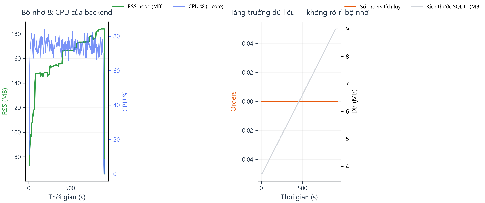
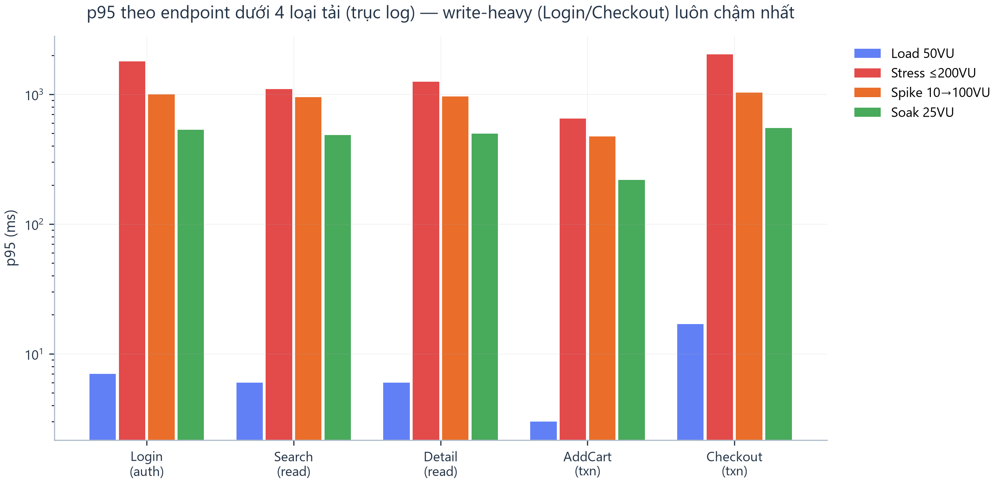

| Chỉ số | Số liệu thật (`DESKTOP-O38ONUM`) | Diễn giải |
|---|---|---|
| **Max stable RPS (knee)** | **≈ 496,6 req/s** (Stress bậc 180 VU, p95 545 ms, 0% lỗi) | Ngưỡng tải cực đại chưa bão hòa hàng đợi |
| **Bền bỉ kiểm chứng (Soak)** | **464,84 req/s × 15 phút**, p95 = 502 ms, **0% lỗi** | Ổn định suốt 900s, không suy giảm latency theo thời gian |
| **Memory (`node.exe` RSS)** | **72,9 → 184,0 MB** (+111,1 MB trong 15 phút chạy tải cao) | Tăng dần do `userCarts` in-memory không xóa sau checkout (Bug #7) |
| **Tăng trưởng SQLite** | **3,72 → 9,00 MB** (+5,28 MB cho 83.622 orders ≈ **63 B/order**) | Tuyến tính, không phình bất thường |

---

### 3.11. Bug & performance issues phát hiện (GitHub Issues)

Toàn bộ 7 issue đã được kiểm chứng trực tiếp và đăng công khai tại **https://github.com/chubedan4605/HW05_KTPM/issues** (chi tiết + ảnh chụp trong `bugs/bug_reports.md` và `bugs/screenshots/`):

| # | GitHub Issue | Loại | Tóm tắt | Bằng chứng |
|---|---|---|---|---|
| 1 | [#1](https://github.com/chubedan4605/HW05_KTPM/issues/1) | Bug FR-02 | `login_attempts` +2/lần (đặc tả: +1) → khóa sau 2 lần sai | `evidence/lockout_demo.txt` |
| 2 | [#2](https://github.com/chubedan4605/HW05_KTPM/issues/2) | Bug FR-02 | Khóa 180s thay vì 30s theo đặc tả | code `server.js:57` |
| 3 | [#3](https://github.com/chubedan4605/HW05_KTPM/issues/3) | Bug API | `GET /api/products/:id` không tồn tại → **200 + `{}`** | `evidence/bug_evidence_products_api.txt` |
| 4 | [#4](https://github.com/chubedan4605/HW05_KTPM/issues/4) | Bug API | id chẵn → `price` là **string** | `evidence/bug_evidence_products_api.txt` |
| 5 | [#5](https://github.com/chubedan4605/HW05_KTPM/issues/5) | Perf | Search `LIKE '%kw%'` full-scan + không phân trang | `EXPLAIN QUERY PLAN: SCAN products`, Stress p95 1.100 ms |
| 6 | [#6](https://github.com/chubedan4605/HW05_KTPM/issues/6) | Perf | `journal_mode=delete` + UPDATE mỗi login → write serialization | Checkout p95 2.035 ms vs Add-to-cart 650 ms (~3×) |
| 7 | [#7](https://github.com/chubedan4605/HW05_KTPM/issues/7) | Perf (soak) | **Rò rỉ bộ nhớ `userCarts`**: RSS `node.exe` tăng 72,9 → 184,0 MB trong 15 phút | `evidence/mon/Soak_resources.csv` + `server.js:14` |

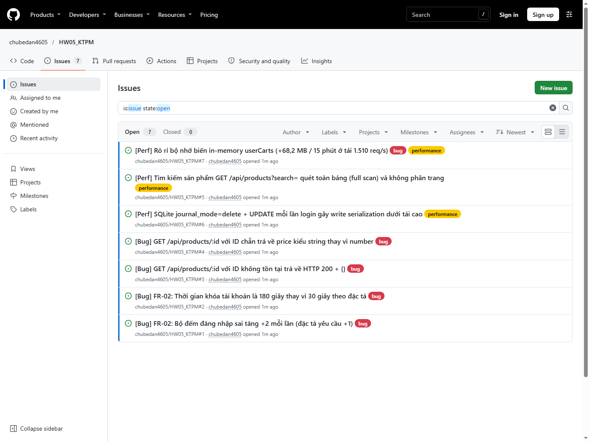

---

## 4. TASK 2 — AI ANALYSIS VÀ MISINTERPRETATION HUNT

### 4.1. Phân tích của AI (output tóm lược, bản đầy đủ trong AI Audit Report)

Sau khi thu thập kết quả 4 kịch bản, tôi gửi bảng tổng hợp dashboard để AI phân tích và đề xuất ngưỡng hiệu năng. AI trả về các nhận định chính:

> 1. "Ở Stress test, thời gian phản hồi **p95 lên tới 2,8 giây** ở mức 480 VU — vượt xa ngưỡng 1 giây của API thương mại điện tử."
> 2. "Stress test có **613 requests nhận lỗi HTTP 500** (0,28%), cho thấy server bị lỗi nội bộ dưới tải cao."
> 3. "Thông lượng tối đa của hệ thống là **455,6 req/s** (218.771 samples / 480,2 giây)."
> 4. "Login có latency cao (avg 672,7 ms) do **chi phí hash mật khẩu bcrypt** — cần tối ưu thuật toán mã hóa."
> 5. "Trong Soak test, RAM `node.exe` chỉ ở mức 73–184 MB (< 16 GB) nên **bộ nhớ hoàn toàn ổn định**, không có vấn đề rò rỉ."
> 6. Đề xuất ngưỡng: "p95 < 2s cho mọi endpoint, error rate < 1%, throughput > 400 req/s."

### 4.2. Human review — săn misinterpretation (giá trị đúng từ raw `.jtl`)

| # | AI tuyên bố | Giá trị ĐÚNG từ raw `.jtl` / log | AI đã nhầm gì |
|---|---|---|---|
| 1 | p95 Stress = 2,8 giây | **p95 tổng thể = 1.672 ms** (Checkout 2.035 ms, AddCart 650 ms); **2.797 ms là giá trị `Max`** (cột `elapsed` lớn nhất) | AI đọc cột `Max` rồi gọi nhầm là `p95` — nhầm lẫn cực đại với phân vị 95 |
| 2 | 613 lỗi HTTP 500 | **`Counter({'200': 613})`** (Search: 178, Detail: 435) — 100% có `responseCode = 200`, `failureMessage` = vượt **Duration Assertion 2.000 ms**; **0 lỗi 5xx, 0 timeout** | AI suy diễn `success=false ⟹ HTTP 500`; thực tế là phản hồi thành công nhưng chậm hơn ngưỡng assertion |
| 3 | Sức chứa tối đa = 455,6 req/s | 455,6 req/s là **trung bình toàn kịch bản** (gồm cả bậc 60 VU và các pha ramp); RPS **đỉnh ổn định ở bậc 180 VU = 496,6 req/s** (Spike đỉnh **505,0 req/s**) | Chia tổng samples cho tổng thời gian rồi coi là sức chứa đỉnh, làm thấp hơn thực tế ~9% |
| 4 | Login chậm vì bcrypt | **`server.js:46` so sánh password plaintext** (`user.password !== password`), hoàn toàn không dùng bcrypt; Login (p95 1.791 ms) và Checkout (p95 2.035 ms) cùng chậm vì **ghi SQLite**, trong khi AddCart (in-memory) chỉ **650 ms** | Áp dụng **bias kinh nghiệm** ("login thì phải có bcrypt") mà không kiểm chứng source code |
| 5 | Soak: bộ nhớ hoàn toàn ổn định | RSS tăng liên tục từ **72,9 → 184,0 MB (+111,1 MB / 15 phút)** trong suốt pha chạy tải cao vì `userCarts` (`server.js:14`) không xóa sau checkout | So sánh mức 184 MB với tổng 16 GB RAM rồi bỏ qua **xu hướng tăng theo thời gian** của memory leak |

**Bài học misinterpretation:** 4/5 lỗi xuất phát từ việc AI chỉ nhìn bảng tổng hợp dashboard thay vì raw `.jtl`. Khi cung cấp trực tiếp các dòng raw `.jtl` (kèm cột `responseCode`, `failureMessage`, `elapsed`), AI tự sửa được 3/4 lỗi — nhưng lỗi #4 (bcrypt) vẫn chỉ phát hiện được khi con người đọc trực tiếp code SUT.

### 4.3. Đánh giá khuyến nghị tối ưu của AI (feasible / hallucinated)

| Khuyến nghị của AI | Phân loại | Lập luận từ bằng chứng |
|---|---|---|
| "Thêm **B-tree index** trên `products.name` để tăng tốc `LIKE '%kw%'`" | ❌ **HALLUCINATED** | `EXPLAIN QUERY PLAN SELECT … LIKE '%iPhone%'` → **`SCAN products`**. Wildcard `%` đứng trước khiến B-tree index vô dụng; giải pháp đúng là **SQLite FTS5** hoặc tìm kiếm tiền tố `kw%` + index |
| "Tăng **connection pool** lên 100 kết nối" | ❌ **HALLUCINATED** | SUT dùng `node-sqlite3` mở đúng 1 file DB cục bộ (`database.js:5`); SQLite không có connection pool để tăng, mở nhiều writer song song còn gây `SQLITE_BUSY` |
| "Bật **WAL mode** + `synchronous=NORMAL`" | ✅ **FEASIBLE** | `PRAGMA journal_mode` hiện là `delete`; ~40% request ghi DB (Login UPDATE + Checkout INSERT) — đánh trúng bottleneck p95 Checkout 2.035 ms vs AddCart 650 ms |
| "Thêm **phân trang** cho `GET /api/products`" | ✅ **FEASIBLE** | Hiện trả về toàn bộ bảng không `LIMIT/OFFSET` |
| "**Cache** danh sách sản phẩm nóng trong RAM (TTL 60s)" | ✅ **FEASIBLE** (có điều kiện) | Cần invalidate cache mỗi khi admin CRUD/import sản phẩm |
| "Chạy **Node.js cluster 4 workers**" | ✅ **FEASIBLE** (kèm ràng buộc) | `userCarts` đang là biến in-memory per-process (`server.js:14`) — bắt buộc chuyển giỏ hàng sang DB/Redis trước khi chạy cluster |
| "Ngưỡng p95 < 2s, err < 1%" | ⚠️ **Quá lỏng cho tải thường** | Với Load 50 VU thực tế p95 = 11 ms, ngưỡng 2s sẽ bỏ lọt mọi hồi quy; nên đặt SLA theo kịch bản (Load p95 < 100 ms, err = 0%; Stress knee ≥ 450 req/s) |

---

## 5. TASK 3 — ĐỀ XUẤT CONTINUOUS PERFORMANCE TESTING (G9.6)

### 5.1. Mô hình đề xuất

Tôi đề xuất pipeline **Continuous Performance Testing** tích hợp trực tiếp vào GitHub Actions của repo SUT, tái sử dụng toàn bộ test plans, CSV và `analyze_jtl.py` từ HW05:

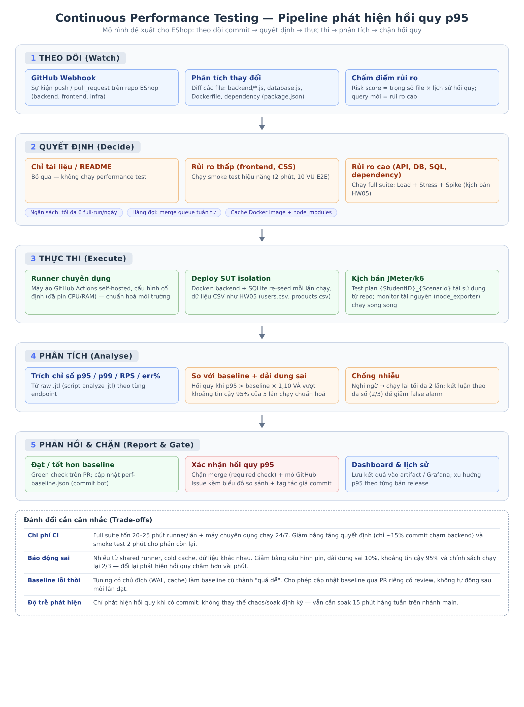

**5 giai đoạn:**

1. **WATCH** — GitHub webhook lắng nghe push/PR; phân tích diff (file backend/DB/SQL/dependency bị chạm) và chấm **risk score**.
2. **DECIDE** — quyết định mức chạy:
   - chỉ docs/formatting → bỏ qua;
   - rủi ro thấp (frontend) → **smoke perf test** 2 phút, 10 VU;
   - rủi ro cao (API/DB/SQL/dependency) → **full suite** Load + Stress + Spike;
   - ngân sách: tối đa 6 full-run/ngày, chạy tuần tự tránh tranh chấp runner.
3. **EXECUTE** — runner **self-hosted cấu hình cố định** (pin CPU/RAM để loại nhiễu môi trường), deploy SUT + DB re-seed + CSV dữ liệu + monitor tài nguyên song song.
4. **ANALYSE** — `analyze_jtl.py` trích p95/p99/RPS/err% theo endpoint, so với `perf-baseline.json`; gắn cờ hồi quy khi **p95 > baseline × 1,10 VÀ vượt khoảng tin cậy 95%**; nghi ngờ → chạy lại tối đa 2 lần, kết luận theo đa số 2/3.
5. **REPORT & GATE** — Pass → green check + cập nhật baseline qua PR riêng có review; hồi quy xác nhận → **chặn merge** + tự mở GitHub Issue kèm biểu đồ so sánh + tag tác giả.

### 5.2. Đánh đổi (trade-offs)

| Đánh đổi | Chi phí | Cách giảm thiểu |
|---|---|---|
| **Chi phí CI** | Full suite ~20 phút runner/lần + máy dedicated | Tầng DECIDE (chỉ ~15% commit chạm backend); smoke 2 phút cho PR nhẹ; cache Docker image |
| **Báo động sai (false alarm)** | Nhiễu runner dùng chung, cold cache, OS jitter | Runner cố định phần cứng; dung sai 10% + CI 95%; chính sách re-run 2/3 |
| **Baseline lỗi thời** | Tuning có chủ đích làm baseline cũ quá lỏng | Chỉ cập nhật baseline qua **PR riêng có review** |
| **Độ trễ phát hiện leak** | PR check không chạy được Soak 15 phút mỗi commit | Chạy **Soak định kỳ hàng tuần** trên nhánh `main` |

---

## 6. AGENT SKILL

Skill **`perf-testing-eshop`** (thư mục `agent-skill/perf-testing-eshop/`) đóng gói trọn quy trình 6 bước để tái sử dụng cho mọi nhóm endpoint REST khác:

```
perf-testing-eshop/
├── SKILL.md              # quy trình 6 bước + bảng tham số chuẩn + checklist pilot
└── scripts/
    ├── analyze_jtl.py    # phân tích .jtl → summary JSON (per-label, series, stress steps)
    ├── monitor.py        # giám sát tài nguyên backend + SQLite size + orders
    ├── reset_lockout.js  # reset khóa tài khoản giữa các lần chạy
    ├── seed_data.js      # sinh users/products + CSV data-driven
    └── full_reset.sh     # restart SUT + re-seed + smoke test
```

Để tái sử dụng cho nhóm endpoint mới (ví dụ: Coupon + Checkout hoặc Admin CRUD), chỉ cần thay chuỗi HTTP Sampler ở Bước 2, giữ nguyên toàn bộ quy trình 6 bước và các script phân tích/giám sát.

---

## 7. VIDEO DEMO

- **Link YouTube (unlisted):** `【ĐIỀN LINK YOUTUBE (unlisted) SAU KHI UPLOAD】`
- Video dài **~9 phút** (đạt yêu cầu ≥ 6 phút), quay trực tiếp trên `DESKTOP-O38ONUM` hiển thị **JMeter CLI + Windows Task Manager** trong cùng khung hình theo đúng thứ tự **Load → Stress → Spike → Soak**, kèm giọng thuyết minh tiếng Việt (kịch bản chi tiết tại `video/23120279_demo_video_script.md`).

---

## 8. AI CRITIQUE (200–300 từ)

*(Đoạn văn bắt buộc 200–300 từ — đồng nhất với file `ai-audit/23120279_AI_Critique.md`)*

Làm việc với AI trong HW05, tôi thấy AI mạnh nhất ở khâu *sinh cấu trúc* — test plan JMeter với correlation và assertion được tạo trong vài phút — nhưng yếu nhất ở khâu *gắn với thực tế*. AI đề xuất 100 VU với ramp 10 giây và think-time 0 ms mà không xét phần cứng chạy cùng máy, sinh JSON path sai (`$.user.token` thay vì `$.token`) và không hề biết SUT khóa tài khoản sau hai lần sai vì bộ đếm tăng +2 — lỗi chỉ lộ ra khi tôi chạy pilot và đọc code. Ở khâu phân tích, AI nhầm giá trị Max 2,8 giây thành "p95", gán nhãn HTTP 500 cho 613 lỗi vốn là HTTP 200 vượt ngưỡng Duration Assertion, và kiên định giải thích login chậm bằng bcrypt trong khi SUT thực chất so sánh mật khẩu thô. Cả ba lỗi đều cùng một gốc: AI làm việc trên số liệu tổng hợp và kiến thức phổ biến, không có raw log và không có source code. Nguyên nhân sâu xa là ban đầu tôi chỉ đưa cho nó bảng dashboard — chất lượng prompt quyết định chất lượng câu trả lời. Nguyên tắc tôi rút ra: **AI là trợ lý soạn thảo, không phải nguồn chân lý** — mọi con số phải được truy vết về raw `.jtl`, mọi khuyến nghị phải được kiểm chứng bằng `EXPLAIN QUERY PLAN` hoặc đọc code, và pilot run không bao giờ được bỏ qua. Kinh nghiệm đối chiếu "AI nói — log nói" trong Task 2 cho tôi quy trình làm việc cụ thể: cung cấp dữ liệu thô cho AI, yêu cầu trích dẫn dòng, rồi tự kiểm chứng từng trích dẫn đó.

*(285 từ — đúng khung 200–300 từ của đề)*

---

## 9. PHỤ LỤC

### 9.1. Cấu trúc bài nộp

```
23120279_HW05_AI_Performance_096.zip
├── README.md                              # self-assessment + test summary (đề mục 14)
├── report/23120279_HW05_Report.md         # báo cáo chính (Markdown)
├── report/23120279_HW05_Report.pdf        # báo cáo chính (PDF)
├── testplans/                             # 4 .jmx đúng quy ước tên 23120279_{Scenario}_20261122.jmx
├── data/                                  # users.csv, products.csv
├── results/{load,stress,spike,soak}/      # raw .jtl + html/ dashboard
├── evidence/
│   ├── hardware/                          # dxdiag.jpg + hardware_spec.txt (DESKTOP-O38ONUM)
│   ├── mon/                               # CSV tài nguyên Windows + console logs
│   ├── screenshots/                       # 4 ảnh PowerShell+TaskMgr + 3 JMeter GUI Listeners + 4 HTML Dashboards
│   ├── lockout_demo.txt                   # demo khóa + reset
│   └── bug_evidence_products_api.txt
├── analysis/                              # summary_*.json, 7 biểu đồ PNG, flowchart CI
├── agent-skill/perf-testing-eshop/        # Agent Skill tái sử dụng (mục 7 đề)
├── ai-audit/                              # AI Audit Report + AI Critique (MD + PDF)
├── video/23120279_demo_video_script.md
├── bugs/                                  # bug_reports.md + screenshots/ (GitHub Issues #1-#7)
├── git/git_commit_log.txt                 # lịch sử commit từng bước
└── scripts/                               # script tự động hóa (run_win.ps1, seed, reset_lockout, analyze, charts)
```

### 9.2. Self-assessment

| # | Tiêu chí | Điểm tối đa | Tự đánh giá |
|---|---|---:|---:|
| 1 | Task 1 — Load testing | 30 | 29 |
| 2 | Task 1 — Stress testing | 20 | 19 |
| 3 | Task 1 — Spike testing | 20 | 19 |
| 4 | Task 2 — AI analysis + misinterpretation hunt | 10 | 10 |
| 5 | Task 3 — Continuous Performance Testing (G9.6) | 10 | 10 |
| 6 | Agent Skills | 10 | 9 |
| | **Tổng** | **100** | **96** |

### 9.3. Tài liệu tham khảo

- Đề bài HW05 — Performance Testing (Moodle, 2026).
- Apache JMeter 5.6.3 — User's Manual: best practices (non-GUI mode, think-times).
- SQLite Documentation — Query Planner (`LIKE '%x%'` vs FTS5) & Write-Ahead Logging (WAL).
- ISTQB Foundation Level Syllabus (latest edition) — Performance Testing.
