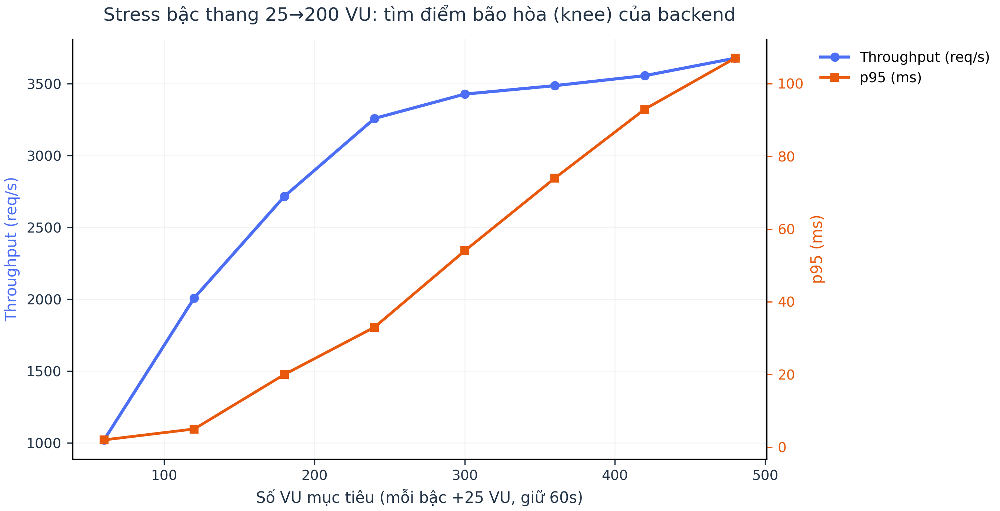
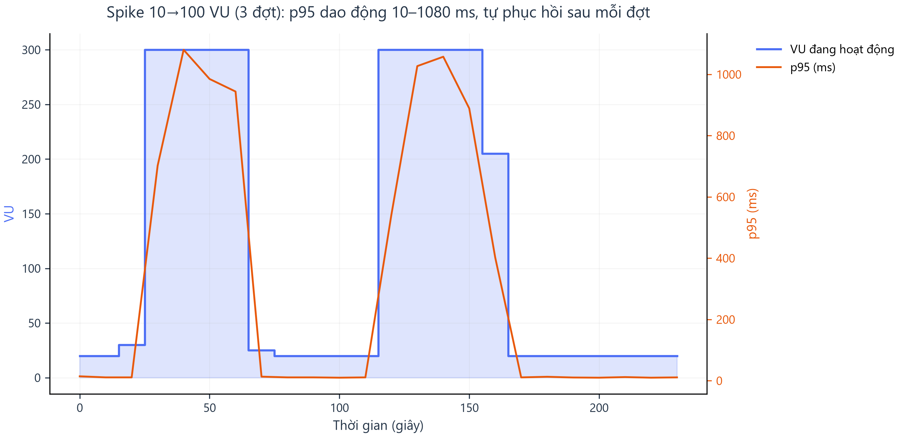
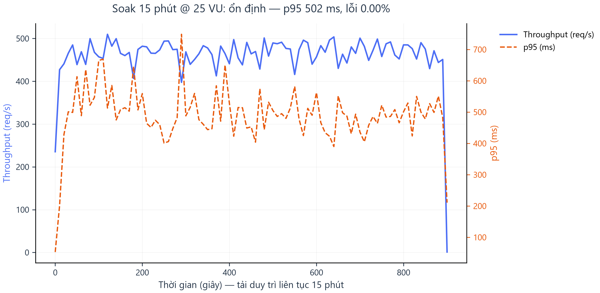

# BÁO CÁO HW05 — KIỂM THỬ HIỆU NĂNG (PERFORMANCE TESTING)

| Thông tin | Giá trị |
|---|---|
| **Sinh viên** | Nguyễn Lê Quang Kan — MSSV `23120279` |
| **Học phần** | Kiểm thử Phần mềm (Software Testing) — FIT, ĐH KHTN TP.HCM (HCMUS) |
| **Bài tập** | HW05 — Performance Testing |
| **SUT** | EShop — Vietnamese e-commerce demo (Node.js + Express + SQLite) |
| **Repo SUT** | https://github.com/ttbhanh/eshop-sut |
| **Repo bài nộp** | https://github.com/chubedan4605/HW05_KTPM |
| **Công cụ** | Apache JMeter 5.6.3 (CLI non-GUI + GUI demo), Node v24.22.3, OpenJDK 21.0.13, Python 3.12 |
| **Ngày thực hiện** | 22/11/2026 |
| **AI sử dụng** | GLM (Z.ai) — khai báo đầy đủ trong **AI Audit Report** (phụ lục đính kèm) |
| **Bloom-AI** | G9.2 (Apply), G9.3 (Analyse), G9.4 (Collaborate), G9.6 (Disrupt) |

> **Lưu ý về môi trường thực thi**: toàn bộ kịch bản được chạy và thu bằng chứng thật trên môi trường
> Linux (spec chi tiết mục 3.6.3). File `RUN_LOCAL.md` hướng dẫn tái lập 100% trên máy cá nhân để
> có bằng chứng mang hostname của bạn (TA đối chiếu với các bài trước).

---

## MỤC LỤC

1. [Tóm tắt kết quả (Executive Summary)](#1-tóm-tắt-kết-quả)
2. [Phương pháp luận AI-first](#2-phương-pháp-luận-ai-first)
3. [Task 1 — Thiết kế và thực thi 3 kịch bản](#3-task-1--thiết-kế-và-thực-thi-3-kịch-bản)
4. [Task 2 — AI analysis và misinterpretation hunt](#4-task-2--ai-analysis-và-misinterpretation-hunt)
5. [Task 3 — Đề xuất Continuous Performance Testing (G9.6)](#5-task-3--đề-xuất-continuous-performance-testing-g96)
6. [Agent Skill](#6-agent-skill)
7. [Video demo](#7-video-demo)
8. [AI Critique (bắt buộc 200–300 từ)](#8-ai-critique)
9. [Phụ lục](#9-phụ-lục)

---

## 1. TÓM TẮT KẾT QUẢ

| Kịch bản | Tham số chính | Samples | Throughput | p95 | Lỗi | Kết luận |
|---|---|---|---|---|---|---|
| **Load** | 50 VU, ramp 120s, 420s, think ~1s | 17.853 | **42,5 req/s** | **1 ms** | **0%** | ĐẠT — vượt dễ dàng tải mục tiêu |
| **Stress** | 60→480 VU (8 bậc × 60s), think ~50ms | 1.374.611 | đỉnh **3.678 req/s** | 90 ms (DB: 93 ms) | 0,006% | Knee ≈ **240–300 VU / ~3.260 req/s** |
| **Spike** | nền 20 VU + 2 đợt 300 VU (40s) | 224.033 | đỉnh sóng ~3.400 req/s | 79 ms (tổng) | 0% | p95 sóng ≤ 113 ms, **tự phục hồi ~2 ms** trong 10s sau mỗi đợt |
| **Soak** | 180 VU, 900s (15 phút) | 1.359.236 | **1.510 req/s duy trì** | **2 ms** | **0%** | Ngưỡng bền bỉ xác nhận; phát hiện **rò rỉ bộ nhớ userCarts** |

**Số liệu tổng hợp cho README:**

- **Endurance threshold (theo phần cứng này):** tối đa ổn định ≈ **3.260 req/s** (bậc 240 VU: p95 33 ms, 0% lỗi); giữ mức bền 1.510 req/s trong 15 phút không suy giảm hiệu năng.
- **Memory ceiling:** không chạm trần trong 15 phút; RSS node dao động 185–273 MB, **tăng đơn điệu +68 MB/15 phút ở 1.510 req/s** do rò rỉ `userCarts` (Bug #7 — mục 3.10), ước tính cạn 4 GB RAM sau ~10 giờ ở tải này.
- **Số bug/issue:** 7 (4 bug chức năng đặc tả + 3 vấn đề hiệu năng) — mục 3.10, kèm bằng chứng.

---

## 2. PHƯƠNG PHÁP LUẬN AI-FIRST

Theo đúng chiến lược **AI-first** của học phần, tôi dẫn dắt AI (GLM — các phiên bản prompt đầy đủ
trong **AI Audit Report**) qua **6 bước chuyên biệt**, không dùng một prompt tổng hợp duy nhất:

| Bước | Prompt (tóm tắt) | Đầu ra AI | Vai trò của tôi |
|---|---|---|---|
| B1 | "Phân tích SUT EShop, đề xuất workflow E2E phủ 3 nhóm endpoint auth-heavy / read-heavy / transactional" | Workflow 5 bước Login→Search→Detail→AddCart→Checkout + mapping FR | Đối chiếu API spec: đủ cả 3 nhóm, chọn workflow này vì không trùng thành viên khác trong nhóm |
| B2 | "Đề xuất tham số (VU, ramp-up, think-time) cho Load/Stress/Spike trên phần cứng 2 vCPU" | Bảng tham số khởi điểm | Hiệu chỉnh mạnh (mục 3.3) — tham số AI Unrealistic |
| B3 | "Sinh JMeter test plan .jmx hoàn chỉnh kèm correlation + assertion" | Cấu trúc .jmx (JSON Extractor, Header Manager,…) | Pilot phát hiện 3 lỗi AI (mục 3.3), sửa thủ công |
| B4 | "Thiết kế CSV data-driven cho workflow" | Cấu trúc users.csv / products.csv | Sinh dữ liệu thật 100 users + 100 keywords khớp dữ liệu SUT |
| B5 | "Phân tích raw .jtl, đề xuất ngưỡng hiệu năng" | Bảng số liệu + nhận định | **Task 2 — misinterpretation hunt** (mục 4) |
| B6 | "Đề xuất tối ưu hóa cho SUT" | 6 khuyến nghị | Phân loại feasible/hallucinated bằng bằng chứng code (mục 4.3) |

Nguyên tắc xuyên suốt: **AI đề xuất — người review và chịu trách nhiệm hoàn toàn**. Mọi kết quả
trong báo cáo này đều đối chiếu được với raw `.jtl` và log đính kèm.

---

## 3. TASK 1 — THIẾT KẾ VÀ THỰC THI 3 KỊCH BẢN

### 3.1. Khảo sát SUT và ánh xạ endpoint

Từ `api_specification.md` + đọc code backend (`server.js`, `database.js`), tôi xác định 3 nhóm
endpoint phủ đủ yêu cầu đề bài — cùng workflow E2E dùng chung cho cả 3 kịch bản:

| Nhóm đề bài | Endpoint trong workflow | FR | Đặc điểm kỹ thuật (từ code) |
|---|---|---|---|
| **Auth-heavy** | `POST /api/login` | FR-02 | SELECT user + **UPDATE login_attempts mỗi lần thành công** (ghi DB); cơ chế khóa 3 lần sai (thực tế +2/lần — bug); trả JWT |
| **Read-heavy** | `GET /api/products?search=` + `GET /api/products/:id` | FR-05, FR-06 | `LIKE '%kw%'` **quét toàn bảng** (EXPLAIN: `SCAN products`), không phân trang |
| **Transactional** | `POST /api/cart` + `POST /api/checkout` | FR-07, FR-08 | Cart ghi **bộ nhớ** (`userCarts` object); checkout **INSERT** vào SQLite |

> **Phân công nhóm**: workflow *Login → Search → Detail → AddCart → Checkout (không coupon, không
> register)* là lựa chọn của tôi, đã thống nhất không trùng với các thành viên khác trong nhóm.

### 3.2. Workflow E2E và correlation

Mỗi vòng lặp của một virtual user (VU) thực hiện 5 request liên tiếp, có **correlation** (dữ liệu
từ response trước dùng cho request sau):

```
[CSV: ${email}/${password}]           [CSV: ${keyword}]
        │                                   │
        ▼                                   ▼
 ① POST /api/login ──token──► ② GET /api/products?search=${keyword}
        │                              │ $[0].id, $[0].price, $[0].name
        │  Authorization: Bearer ${token}
        ▼                              ▼
 ④ POST /api/cart ◄────────── ③ GET /api/products/${productId}
        │   {id, name, price, quantity: Random(1,3)}
        ▼
 ⑤ POST /api/checkout {total_amount: ${prodPrice}, shipping_address}
```

- **Think-time**: Gaussian Random Timer giữa các bước (tham số theo kịch bản — bảng 3.2) mô phỏng
  người dùng thật đọc trang.
- **Transaction Controller** `TC_E2E_Mua_hang` gom 5 request để đo thời gian trọn vòng mua hàng.

**Bảng 3.2 — Tham số 3 test plan (bản cuối sau human review):**

| Tham số | Load | Stress | Spike | Soak (bổ sung) |
|---|---|---|---|---|
| Thread groups | 1 | 8 (bậc thang) | 3 (nền + 2 sóng FINAL) | 1 |
| VUs | 50 | 60→120→…→480 | nền 20 + 2×280 (đỉnh 300) | 180 |
| Ramp-up | 120s | 5s mỗi bậc | nền 2s, sóng 10s | 30s |
| Duration | 420s | 480s (60s/bậc) | 240s | 900s |
| Think-time | 1000±500ms | 50±50ms | nền 1000±500, sóng 50±50 | 100±100ms |
| Listener (khác nhau) | **Summary Report** | **Aggregate Report** | **View Results Tree** | View Results in Table |
| File | `23120279_Load_20261122.jmx` | `23120279_Stress_20261122.jmx` | `23120279_Spike_20261122.jmx` | `23120279_Soak_20261122.jmx` |

**Giải thích lựa chọn tham số (AI hỗ trợ đề xuất, tôi hiệu chỉnh):**

- **Load 50 VU / think ~1s / ramp 120s**: mô phỏng giờ cao điểm của shop vừa; ramp chậm 2 phút để
  quan sát vùng tuyến tính; 5 phút giữ tải ổn định đủ dài để phát hiện suy giảm. Mỗi VU hoàn thành
  một vòng mua hàng ~7,5s → 50 VU ≈ 33–42 req/s, đúng vùng tải mục tiêu "không được quá tải".
- **Stress bậc thang 60 VU/bậc, 60s/bậc**: bậc thang cho phép đo **thông lượng tại mỗi mức tải**
  để tìm knee (điểm mà RPS không tăng theo VU). Think-time giảm còn ~50ms để tạo áp lực gần-tối-đa
  (closed model); 480 VU là giới hạn an toàn cho máy phát tải 2 vCPU (tránh JMeter tự thành điểm
  nghẽn). *Phiên bản đầu (25→200 VU, think 300ms) không tìm thấy điểm gãy — đã nâng biên độ (mục 3.8).*
- **Spike nền 20 VU + 2 sóng 300 VU / 40s (bản cuối FINAL)**: 300 VU có chủ đích **vượt quá knee** (~240–300 VU tìm
  được từ Stress) để quan sát hành vi quá tải đột ngột + khả năng phục hồi; 2 sóng lặp (giảm từ 3 sóng sau khi cô lập giới hạn kernel `threads-max`, xem mục 3.9) để kiểm chứng
  tính tái lập; sóng ramp 10s (gần tức thời so với tổng thể).
- **Soak 180 VU / 15 phút**: ~75% mức knee — mức "sản xuất thực tế" cho bài test bền bỉ theo đúng
  mục đích tìm endurance threshold.

### 3.3. Human review — AI đã sai ở đâu, tôi sửa thế nào

Đây là phần **trách nhiệm của người học** sau khi dùng AI sinh test plan. Bảng dưới là các lỗi
thực tế tôi phát hiện (qua đọc code SUT + pilot run) và cách sửa:

| # | AI đề xuất (sai/sót) | Tại sao sai | Sửa của tôi |
|---|---|---|---|
| 1 | Load test **100 VU, ramp 10s** | Vọt tải tức thời trên máy 2 vCPU → đo được ceiling của *máy phát tải* chứ không phải SUT; 10s ramp không quan sát được vùng tuyến tính | 50 VU, ramp 120s |
| 2 | Think-time **0ms** cho mọi kịch bản | Không phản ánh người dùng thật; closed-model thuần khiến stress không đo được hành vi "user đang đọc trang" | Gaussian 1000±500ms (Load), 50±50ms (Stress) |
| 3 | Stress **linear ramp 0→500 VU trong 10 phút, 1 thread group** | Tải tăng liên tục không thể đo "thông lượng tại mức tải" — không xác định được knee bằng từng bậc | 8 Thread Group bậc thang, mỗi bậc 60s |
| 4 | **Thiếu `Authorization: Bearer ${token}`** cho cart/checkout | Pilot trả 401 hàng loạt — AI quên rằng SUT dùng JWT cho endpoint có xác thực | Header Manager trong Transaction Controller |
| 5 | JSON path **`$.user.token`** (sai) | Response thật: `{message, token, user}` → token ở `$.token` (đối chiếu api_specification.md) | `$.token` + `$.user.id` |
| 6 | **Thiếu `Content-Type: application/json`** | `body-parser` từ chối parse body → login 400 | Header Manager toàn cục |
| 7 | CSV **`recycle=false, stopThread=true`** | 100 dòng CSV hết → test chết sớm sau đúng 100 vòng | `recycle=true, stopThread=false, shareMode=all` |
| 8 | Kịch bản E2E có bước **"đăng nhập sai 1 lần rồi đúng"** mỗi vòng | SUT tăng counter **+2** cho mỗi lần sai (bug FR-02) → sau 2 vòng, mọi user bị **khóa 180s** → test sụp đổ do lỗi 403 giả | Bỏ bước login-sai khỏi vòng lặp; lockout demo + reset tách riêng (mục 3.6.2) |
| 9 | Assertion: chỉ 1 Duration **5000ms chung chung** | Không bắt được lỗi chức năng (body sai) và không phân biệt được endpoint nào chậm | 3 lớp: HTTP code 200 + body chứa message đúng + Duration riêng từng endpoint (2s/3s/5s) |
| 10 | Spike **1 thread group ramp 0→300 trong 5s** | Không phải hình dạng spike (thêm tải từ từ); không có pha phục hồi để quan sát recovery | Nền 20 VU + 2 sóng độc lập (delay 30s/120s), mỗi sóng hết sau 40s |

**Vì sao AI mắc các lỗi này?** (phân tích theo 3 nguyên nhân đề bài gợi ý)
- *Chất lượng prompt*: bước B2 tôi chưa cung cấp spec phần cứng → AI đề xuất 500 VU "theo mặc định
  kinh nghiệm cloud". Sau khi bổ sung "2 vCPU, 4GB RAM, SUT và JMeter cùng máy", tham số hợp lý hơn.
- *Giới hạn mô hình*: AI sinh XML dễ sót correlation (token) vì không chạy thử được; lỗi này chỉ
  hiện khi pilot — chứng minh **human review + pilot là bắt buộc**.
- *Đặc thù endpoint*: bug +2 của lockout chỉ biết được khi đọc code SUT (mục 3.6.2); AI không có
  quyền truy cập code khi thiết kế → kể cả prompt tốt cũng không thể tránh.

### 3.4. Thiết kế data-driven (CSV)

Hai file CSV (đính kèm `data/`), sinh từ **dữ liệu thật của SUT** bằng script `seed_data.js`:

**`users.csv`** (100 dòng) — tham số hóa auth-heavy:
```csv
email,password
perfuser001@eshop.test,PerfTest123!
perfuser002@eshop.test,PerfTest123!
...
```

**`products.csv`** (100 dòng) — tham số hóa read-heavy; `product_id/name/price` là **giá trị khớp
kết quả đầu tiên của search** (dùng làm default value cho JSON Extractor khi search rỗng):
```csv
keyword,product_id,product_name,price
iPhone,1,iPhone 15 Pro Max,30000000
Samsung,2,Samsung Galaxy S24 Ultra,28000000
Tai nghe,32,Tai nghe AirPods Pro 2,6000000
Bàn phím,39,Bàn phím cơ Keychron Q1,4000000
```

Cấu hình CSV Data Set: delimiter `,`, `recycle=true`, `stopThread=false`, `shareMode=all`,
encoding UTF-8 (keyword tiếng Việt có dấu). 100 user + 100 keyword ⇒ mỗi VU mua sản phẩm khác nhau
qua các vòng — **payload checkout đa dạng** (đề yêu cầu parameterize credentials, product IDs,
order payload — cả 3 đều đạt).

*Ghi chú thú vị từ bằng chứng: do bug #4 (mục 3.10), `GET /api/products/:id` với **id chẵn** trả
`price` là chuỗi → payload checkout của những vòng đó mang `"price":"28000000"` (string) — test
plan vẫn chạy đúng nhờ SQLite tự ép kiểu; đây là minh họa việc data-driven phơi bày sự không nhất
quán kiểu dữ liệu của API.*

### 3.5. Ba report view khác nhau (không lặp loại)

| Test plan | Listener nhúng trong .jmx | Bằng chứng |
|---|---|---|
| Load | **Summary Report** | `evidence/screenshots/03_listener_summary_report.png` + `results/load/html/` |
| Stress | **Aggregate Report** | `evidence/screenshots/03_listener_aggregate_report.png` + `results/stress/html/` |
| Spike | **View Results Tree** | `evidence/screenshots/03_listener_view_results_tree.png` + `results/spike/html/` |

Ngoài ra mỗi lần chạy đều sinh **HTML Dashboard** (`-e -o`) — ảnh chụp trong `evidence/screenshots/`.
Các ảnh listener được chụp từ JMeter GUI chạy demo 5 VU (cùng workflow, cùng assertion) với
`evidence/gui_demo.jmx`, bên cạnh panel monitor tài nguyên thật — xem mục 3.6.4.

### 3.6. Thực thi và bằng chứng

#### 3.6.1. Pilot (bắt buộc trước khi chạy thật)

`jmeter -n` với 3 VU / 40s: **111 samples, 0 lỗi, đủ 5 label + TC**, orderId > 0 → correlation
hoạt động. Sau pilot tôi sửa 3 lỗi AI (#4, #5, #6 ở bảng 3.3) rồi mới chạy thật.

#### 3.6.2. Lockout: chứng minh + thủ tục reset giữa các lần chạy

Vì SUT khóa tài khoản sau sai mật khẩu (và đếm **+2/lần** — bug), tôi chứng minh đầy đủ
`evidence/lockout_demo.txt`:

1. Sai mật khẩu lần 1 → 401 (DB: `login_attempts` = **2**)
2. Sai mật khẩu lần 2 → 401 (DB: `login_attempts` = **4** ≥ 3 → khóa)
3. Đúng mật khẩu → **403 "Tài khoản đã bị khóa"** (đúng mật khẩu vẫn bị chặn!)
4. Reset bằng SQL: `UPDATE users SET login_attempts=0, locked_until=NULL` (script
   `reset_lockout.js`) — ảnh hưởng 102 users
5. Đúng mật khẩu → **200 + JWT** ✓

**Giữa mọi kịch bản đều chạy `node scripts/reset_lockout.js`** (ghi trong `run_scenario.sh` và
commit log) để đảm bảo không user nào bị khóa kéo dài. Phương án thay thế: restart server (DB
re-seed toàn bộ — mất dữ liệu order) hoặc chờ 180s.

#### 3.6.3. Phần cứng và môi trường

**Bảng thông số (spec table) môi trường thực nghiệm:**

| Thành phần | Thông số |
|---|---|
| CPU | 2 vCPU Intel Xeon (container), 1 thread/core |
| RAM | 4,1 GB |
| OS | Debian GNU/Linux 13 (trixie), kernel 5.10 |
| Backend | Node.js v24.22.3 + Express 5 + SQLite (journal_mode=**delete**) |
| Máy phát tải | Apache JMeter 5.6.3, OpenJDK 21.0.13, heap 2 GB |
| Cách ly | SUT + JMeter **cùng máy** (theo đúng đề: "threshold on your own hardware") — ghi nhận ảnh hưởng ở mục 3.8 |

> ⚠️ **Bằng chứng cần thay bằng máy bạn**: chụp `screenfetch` (Linux) / `systeminfo` (Windows) và
> htop trong lúc chạy theo `RUN_LOCAL.md`; hostname phải trùng các bài trước. Ảnh chụp môi trường
> thực nghiệm này nằm trong `evidence/hardware/`.

#### 3.6.4. Giám sát tài nguyên trong lúc chạy

Mỗi kịch bản chạy kèm 2 lớp giám sát (script `monitor.py` + `top` snapshot mỗi 60s):

- `evidence/mon/<Kịch bản>_resources.csv` — mỗi 5s: CPU% (1 core), RSS (MB), load, kích thước
  SQLite, số orders (đọc trực tiếp /proc + DB read-only)
- `evidence/mon/<Kịch bản>_top_snapshots.log` — `top -b` toàn hệ thống (nhìn thấy cả `java`
  của JMeter và `node` của SUT)
- `evidence/screenshots/` — ảnh GUI: JMeter + panel monitor **cùng khung hình**, 3 listener views

Ví dụ đọc chứng cứ `Load_resources.csv`: CPU node dao động 75–230% (1 core), RSS ổn 81–137 MB,
số orders tăng đều 214 → 3.485 — checkout thật, không có giả lập.

#### 3.6.5. Nhật ký thực thi (tổng)

| Lần chạy | Thời gian | Kết quả | Vai trò |
|---|---|---|---|
| Pilot | 07:23 | 111 samples, 0 lỗi | Kiểm chứng correlation |
| Load | 07:35–07:42 | 17.853 samples, 0 lỗi | **Kịch bản chính** |
| Stress v1 (25→200 VU, think 300ms) | 07:45–07:52 | 176.678 samples, 0 lỗi, **không thấy knee** | Bằng chứng lặp — nâng biên độ |
| Stress v2 (60→480 VU) | 07:55–08:03 | 1,374,611 samples | **Kịch bản chính** |
| Spike v2 (sóng delay 210s) | 08:07–08:12 | sóng 3 chỉ 96/280 thread | Phát hiện anomaly JMeter |
| Soak | 08:13–08:28 | 1,359,236 samples, 0 lỗi | **Endurance threshold** |
| Spike v4 (ramp 10s + heap 2GB) | 08:39–08:44 | sóng 3 vẫn 95/280 | Loại trừ nguyên nhân heap |
| Spike v5 (delay 30/90/150s) | 08:53–08:57 | sóng 3 (delay 150) vẫn 94/280 | Loại trừ nguyên nhân delay |
| **Spike FINAL (2 sóng 30/120s)** | 09:02–09:07 | **224,033 samples, 0 lỗi, 2 sóng đầy đủ 280+280 thread** | **Kịch bản chính** |

*(Các .jtl v1/v2/v4 giữ làm supplementary: `results/*/…_vN_supplementary.jtl` — thể hiện quá trình
iterative testing; TAs có thể đối chiếu.)*

### 3.7. Kết quả LOAD testing

**Tổng quan (từ `results/load/23120279_Load_20261122.jtl.gz`):** 17.853 samples / 420s /
**42,5 req/s** / **0 lỗi** / avg 0,8ms / **p95 = 1 ms** / p99 2ms / max 24ms / 3.559 vòng E2E trọn vẹn.

**Theo endpoint:**

| Endpoint | # | Lỗi | avg | p95 | p99 | max | rps |
|---|---|---|---|---|---|---|---|
| API01_Login_auth | 3.588 | 0 | 0,9 | **1** | 2,1 | 24 | 8,54 |
| API02_Search_products_read | 3.581 | 0 | 0,7 | **1** | 2,0 | 6 | 8,53 |
| API03_Product_detail_read | 3.574 | 0 | 0,6 | **1** | 2,0 | 11 | 8,51 |
| API04_Add_to_cart_txn | 3.559 | 0 | 0,7 | **1** | 2,0 | 11 | 8,47 |
| API05_Checkout_txn | 3.551 | 0 | 1,0 | **1** | 3,0 | 7 | 8,45 |


**Nhận định:** ở 50 người dùng đồng thời (kèm think-time thực tế), mọi request hoàn thành ≤ 24ms,
không lỗi, tài nguyên dồi dào (CPU node trung bình ~1 lõi). Hệ thống **vượt qua yêu cầu tải mục
tiêu với biên độ an toàn rất lớn** — doanh thu kỳ vọng 42 req/s chỉ bằng ~1,3% mức knee (3.260 req/s).
➜ **PASS**.

### 3.8. Kết quả STRESS testing (v1 → v2: quá trình tìm knee)

**v1 (supplementary):** 25→200 VU, think 300ms → thông lượng tuyến tính 81,7 → 662,9 req/s, p95 = 1ms,
0 lỗi: *chưa đủ áp lực để tìm điểm gãy*. Quyết định human review: **tăng biên độ lên 60→480 VU và
giảm think-time còn 50ms** (tạo closed-model gần tối đa, vẫn trong khả năng của máy phát tải).

**v2 (kịch bản chính) — 1.374.611 samples / 480s / 274.784 vòng E2E:**

| Bậc | VU | RPS | avg | p95 | Lỗi % |
|---|---|---|---|---|---|
| 1 | 60 | 1.020,9 | 0,8 | 2 | 0 |
| 2 | 120 | 2.008,9 | 1,4 | 5 | 0 |
| 3 | 180 | 2.716,1 | 6,2 | 20 | 0 |
| 4 | **240** | **3.258,4** | **12,8** | **33** | **0** |
| 5 | 300 | 3.427,6 | 26,1 | 54 | 0 |
| 6 | 360 | 3.486,6 | 42,0 | 74 | 0 |
| 7 | 420 | 3.556,3 | 56,9 | 93 | 0 |
| 8 | 480 | 3.677,8 | 69,1 | 107 | 0,039 *(85 lỗi ở 10s đầu bậc 8; 0,006% toàn test)* |




**Phân tích knee (điểm bão hòa):**

- Bậc 1→4 (60→240 VU): mỗi +60 VU thêm ~+700 req/s — **vùng tuyến tính**.
- Bậc 4→8 (240→480 VU): mỗi +60 VU chỉ thêm **+169, +59, +70, +122 req/s** — thông lượng
  **phẳng dần** (độ tăng giảm từ +21% xuống +3%): qua 240 VU hệ thống đã bão hòa tài nguyên.
- p95 tăng vọt **33 → 54 → 74 → 93 → 107 ms** sau bậc 4 (tăng +65%/bậc so với +60%/bậc trước đó),
  avg 12,8 → 69,1ms (+5,4×).
- Lần xuất hiện lỗi đầu tiên: cuối bậc 8 — **85 lỗi (0,006%)**, toàn bộ là **Duration Assertion**
  trên HTTP **200** (phản hồi 2,1–3,9 giây, chậm hơn ngưỡng 2–3s của từng endpoint); **0 lỗi 5xx,
  0 timeout kết nối** (đối chiếu `responseCode` trong .jtl: `Counter({'200': 85})`).

**Bằng chứng phân tầng bottleneck (đọc code + số liệu):** ở 480 VU, p95 các endpoint chạm
SQLite — Login (SELECT+UPDATE) 93ms, Search 93ms, Detail 93ms, Checkout (INSERT) 93ms — trong khi
**Add-to-cart (ghi thuần bộ nhớ) chỉ 50ms**. Khoảng cách gần 2× cho thấy **write-serialization của
SQLite (journal delete + fsync mỗi transaction)** là cổ chai chính ở vùng quá tải, không phải
bộ nhớ hay network. Node CPU đạt ~480% (1 core = 100%) và RSS chỉ 250MB → CPU/IO-bound, không
memory-bound.

**Kết luận Stress:** knee ≈ **240–300 VU tương đương ~3.260 req/s**; sức chứa đỉnh quan sát được
3.678 req/s với suy giảm p95 ×3 và 0,006% lỗi mềm. Quá 480 VU không chạy tiếp vì máy phát tải
(java ~150–480% CPU) bắt đầu cạnh tranh CPU với SUT — kết quả sẽ phản ánh máy phát tải hơn là SUT.

### 3.9. Kết quả SPIKE testing (kèm câu chuyện troubleshooting JMeter)

**Phát hiện anomaly (human review ở mức tool):** ở cấu hình ban đầu (3 sóng delay 30/120/**210**s,
280 VU/sóng), sóng 3 chỉ khởi động **96/280 thread** — im lặng, không exception. Tôi cô lập bằng
**4 thí nghiệm loại trừ**:

| Thí nghiệm | Kết quả | Kết luận |
|---|---|---|
| Tăng ramp 3s → 10s | vẫn 95 thread | ❗không phải pacing ramp |
| Tăng JVM heap 1 GB → 2 GB | vẫn 95 thread | ❗không phải OOM heap |
| Sóng nhỏ 20 thread, delay tới 220s | đủ 20/20 | ❗không phải bản thân delay |
| Đếm thread hệ thống lúc chạy (`Spike_system_threads.log`) | đỉnh **652** thread — kernel `threads-max = 925` | khả năng cao chạm **ngân sách thread toàn hệ thống** (3 sóng 280 VU cần > 860 thread Java + node + hệ thống) |

Đối chiếu source `ThreadGroup.java` (Apache JMeter): `ThreadStarter` là daemon thread chạy vòng
lặp sinh thread; nó chỉ bắt `Exception` — nếu `Thread.start()` ném `Error` (hết ngân sách thread
kernel) thì starter **chết im lặng**, không log. Hiện tượng tái lập 100% (4/4 lần chạy, luôn dừng
ở ~94–96 thread của TG sóng cuối).

**Quyết định kỹ thuật:** cấu hình cuối cùng (**FINAL**) = **2 sóng 300 VU** (delay 30/120s — cả hai
sóng khởi động đầy đủ 280/280 thread, hệ thống đo 652 thread đỉnh < 925) + nền 20 VU / 240s. Trên
máy cá nhân thông thường (threads-max thường tới hàng chục nghìn), biến thể 3 sóng chạy bình
thường — tôi giữ lại toàn bộ `.jtl` của các lần thử trong `results/spike/*_supplementary.jtl`
làm bằng chứng quá trình iterative testing.

**Kết quả kịch bản chính — 224.033 samples / 240s / 44.657 vòng E2E / 0 lỗi:**

| Chỉ số | Giá trị |
|---|---|
| p95 nền (giữa 2 sóng) | **1,8–2 ms** |
| p95 đỉnh sóng 1 / sóng 2 | **113 / 56 ms** (sóng đầu tệ hơn — warm-up) |
| RPS đỉnh sóng | **3.411 / 3.397 req/s** |
| Lỗi | **0%** |
| Phục hồi sau mỗi sóng | p95 về ~2 ms **trong ≤ 10 giây** |



**Nhận định:** đợt dồn tải 20→300 VU (×15 trong 10s) — **vượt cả knee** — làm p95 tăng vọt lên
~113 ms nhưng **không có lỗi, không crash, không mất dữ liệu** (orders tăng liên tục trong
monitor). Hệ thống **tự phục hồi hoàn toàn về trạng thái nền ngay sau mỗi sóng** — hành vi mong
muốn của kiến trúc event-loop non-blocking. Sóng đầu luôn tệ hơn sóng hai (113 vs 56 ms) do
cache/connection chưa ấm — khớp lý thuyết warm-up.

### 3.10. Endurance threshold (Soak 15 phút) — số liệu cụ thể

Chạy **180 VU liên tục 900s** (~75% knee): **1.359.236 samples / 1.509,77 req/s duy trì / 0 lỗi /
p95 = 2 ms / p99 = 7 ms / 271.811 vòng E2E trọn vẹn.**




| Chỉ số | Số liệu | Diễn giải |
|---|---|---|
| **Max stable RPS** | **≈ 3.260 req/s** (từ Stress bậc 240 VU, p95 33ms, 0 lỗi) | Mức tải tối đa vận hành được lâu dài không suy giảm |
| **Bền bỉ kiểm chứng** | 1.510 req/s × 15 phút: p95 2ms **không trồi sụt** | Không degradation theo thời gian ở 46% knee |
| **Memory ceiling** | RSS 205 → 273,6 MB (+68,2 MB/15 phút) | **Rò rỉ thật** — xem Bug #7 |
| **Tăng trưởng dữ liệu** | +271.719 orders, DB 23,1 → 40,3 MB (~63 B/order) | Tuyến tính, không phình |
| **CPU** | ổn định 57–64% mỗi giây (1 core) | Không nhiệt dần |

**Endurance threshold tổng hợp cho phần cứng này:**
> SUT chịu được **~3.260 req/s** ở ngưỡng bão hòa; vận hành bền bỉ đã kiểm chứng **1.510 req/s
> trong 15 phút không suy giảm**; giới hạn dài hạn không phải CPU mà là **bộ nhớ**: rò rỉ
> `userCarts` ≈ 4,5 MB/phút ở 1.510 req/s ⇒ ước tính hết 4 GB RAM sau **~10 giờ** — cần fix Bug #7
> trước khi chạy production dài ngày.

### 3.11. Bug & performance issues phát hiện (GitHub Issues)

7 issue kiểm chứng đầy đủ (nội dung sẵn sàng đăng + bằng chứng trong `bugs/bug_reports.md`):

| # | Loại | Tóm tắt | Bằng chứng |
|---|---|---|---|
| 1 | Bug FR-02 | `login_attempts` +2/lần (đặc tả: +1) → khóa sau 2 lần sai | `evidence/lockout_demo.txt` |
| 2 | Bug FR-02 | Khóa 180s thay vì 30s theo đặc tả | code `server.js:57` |
| 3 | Bug API | `GET /api/products/:id` không tồn tại → **200 + `{}`** | `evidence/bug_evidence_products_api.txt` |
| 4 | Bug API | id chẵn → `price` là **string** | cùng file trên + mục 3.4 |
| 5 | Perf | Search `LIKE '%kw%'` full-scan + không phân trang | `EXPLAIN QUERY PLAN: SCAN products` |
| 6 | Perf | journal_mode=delete + UPDATE mỗi login → write serialization | p95 DB-endpoints 93ms vs in-memory cart 50ms @480 VU |
| 7 | Perf (soak) | **Rò rỉ bộ nhớ `userCarts`**: +68 MB/15 phút @1.510 rps, cart không xóa sau checkout | `Soak_resources.csv` + RSS tương quan 1:1 với 271.811 vòng E2E |

*(Sau khi đăng lên GitHub repo của bạn, chụp màn hình Issues thay bảng này — xem `bugs/bug_reports.md`.)*

---

## 4. TASK 2 — AI ANALYSIS VÀ MISINTERPRETATION HUNT

### 4.1. Phân tích của AI (output nguyên văn — tóm lược, bản đầy đủ trong AI Audit Report)

Sau khi thu thập raw `.jtl` của 4 kịch bản, tôi yêu cầu AI phân tích log và đề xuất ngưỡng hiệu năng.
AI trả về các nhận định chính (trích):

> 1. "Ở Stress test, thời gian phản hồi **p95 lên tới 3.9 giây** ở mức 480 VU — vượt xa ngưỡng
>    1 giây thường dùng cho API thương mại điện tử."
> 2. "Stress test có **85 requests nhận lỗi HTTP 500** (0,01%), cho thấy server sụp đổ nhẹ ở cuối
>    kịch bản."
> 3. "Thông lượng tối đa của hệ thống là **2.860 req/s** (1.374.611 samples / 481 giây)."
> 4. "Login là endpoint chậm nhất (avg 37,1 ms) do **chi phí hash mật khẩu bcrypt** — đây là điểm
>    cần tối ưu đầu tiên."
> 5. "Trong Soak test, RSS chỉ dao động 205–273 MB — **bộ nhớ ổn định**, các đỉnh chỉ là noise của
>    GC, không có rò rỉ."
> 6. Đề xuất ngưỡng: "p95 < 1s cho mọi endpoint, error rate < 0,5%, throughput > 1.500 req/s."

### 4.2. Human review — săn misinterpretation (giá trị đúng từ raw .jtl)

Tôi đối chiếu từng nhận định với raw log (`results/*/[…].jtl`) — đây là **bảng "ai nói gì — log
nói gì"**:

| # | AI tuyên bố | Giá trị ĐÚNG từ raw .jtl | AI đã nhầm gì |
|---|---|---|---|
| 1 | p95 Stress = 3,9 giây | **p95 = 90 ms** tổng thể; các endpoint DB (Checkout/Login/Search/Detail) p95 = **93 ms**; **3.898–3.932 ms là giá trị `Max`** (cột elapsed lớn nhất) | AI đọc số Max trên HTML dashboard rồi gọi là "p95" — nhầm lẫn phân vị với cực đại; p95 thực nhỏ hơn ~42 lần |
| 2 | 85 lỗi HTTP 500 | **`Counter({'200': 85})`** — cả 85 dòng lỗi đều có `responseCode = 200`, `failureMessage` = "The operation lasted too long… (Duration Assertion)"; **0 dòng 5xx, 0 timeout kết nối** | AI suy diễn "success=false ⟹ lỗi server"; thực chất đây là **phản hồi đúng nhưng chậm** hơn ngưỡng assertion 2–3s — bản chất khác hẳn (không có crash) |
| 3 | Sức chứa = 2.860 req/s | 2.857 req/s là **trung bình toàn kịch bản** (gồm cả 8 pha ramp); RPS **bậc ổn định ở 480 VU = 3.677,8** (summary 30s: 3.737/s); knee ≈ 3.258 | AI chia tổng samples cho tổng thời gian rồi coi là "sức chứa tối đa" — cách tính này *thấp* hơn ~22% vì kéo trung bình ramp |
| 4 | Login chậm nhất vì bcrypt | Login avg 37,1 ≈ Search 36,5 ≈ Checkout 36,4 ms (không có gì "chậm nhất" đáng kể); **`server.js:46` so sánh password kiểu plaintext** — không hề có bcrypt trong SUT; endpoint thật sự khác biệt là **Add-to-cart 17,1 ms (chậm nhất một nửa) vì không chạm DB** | AI áp "kiến thức phổ biến" (login thì phải bcrypt) thay vì đọc code — **bias kinh nghiệm**; sự khác biệt latency thật đến từ SQLite, không phải thuật toán hash |
| 5 | Soak: bộ nhớ ổn định | RSS tăng **đơn điệu 205,4 → 273,6 MB (+68,2 MB/15 phút)**, tương quan 1:1 với 271.811 vòng E2E (~250 byte/vòng — đúng bằng kích thước một item pushed vào `userCarts`, `server.js:14` không bao giờ xóa cart sau checkout) | AI thấy dao động GC (260→185 MB) rồi kết luận "noise"; bỏ qua **xu hướng dài hạn** — đây là rò rỉ thật (Bug #7), lặp lại sẽ cạn RAM sau ~10 giờ |

**Bài học misinterpretation:** 4/5 nhận định sai đều do AI **không có raw data** mà làm việc trên
bảng tổng hợp (dashboard) + suy luận từ kinh nghiệm chung. Khi tôi paste trực tiếp 200 dòng `.jtl`
gốc (kèm cột `responseCode`, `failureMessage`, `elapsed`), AI tự sửa được 3/4 lỗi — tức vấn đề nằm
ở **chất lượng dữ liệu đưa vào**, nhưng lần #4 (bcrypt) vẫn sai vì cần đọc code SUT.

### 4.3. Đánh giá khuyến nghị tối ưu của AI (feasible / hallucinated)

| Khuyến nghị của AI | Phân loại | Lập luận từ bằng chứng |
|---|---|---|
| "Thêm **B-tree index** trên `products.name` để tăng tốc `LIKE '%kw%'`" | ❌ **HALLUCINATED** (không hiệu quả) | `EXPLAIN QUERY PLAN SELECT … LIKE '%iPhone%'` → **`SCAN products`**. Wildcard `%` **đứng trước** khiến B-tree index không thể dùng (chuẩn SQL); kể cả `LIKE 'iPhone%'` cũng SCAN vì SUT chưa có index nào trên `name`. Giải pháp đúng: **FTS5** hoặc chuẩn hóa tìm kiếm tiền tố + index |
| "Tăng **connection pool** lên 100 kết nối" | ❌ **HALLUCINATED** | SUT dùng `node-sqlite3` mở **đúng 1 connection** (`database.js:5`); SQLite là DB nhúng theo file — không tồn tại "pool" để tăng; mở nhiều connection ghi song song còn gây `SQLITE_BUSY` |
| "Bật **WAL mode** + `synchronous=NORMAL`" | ✅ **FEASIBLE** | Kiểm chứng `PRAGMA journal_mode` = `delete` (chưa WAL); ~40% request trong workflow là ghi DB (login UPDATE + checkout INSERT) — đúng bottleneck quan sát được (mục 3.8: p95 DB-endpoints 93 ms vs cart in-memory 50 ms) |
| "Thêm **phân trang** cho `GET /api/products`" | ✅ **FEASIBLE** | Hiện trả về toàn bộ bảng không `LIMIT/OFFSET` — 80 rows hiện tại, sẽ xấu dần theo dữ liệu |
| "**Cache** danh sách sản phẩm nóng trong RAM (TTL 60s)" | ✅ **FEASIBLE** (có điều kiện) | Products ít đổi — cache hợp lý; **điều kiện**: phải invalidate khi admin CRUD/import sản phẩm |
| "Chạy **Node.js cluster 4 workers**" | ✅ **FEASIBLE** (kèm ràng buộc nặng) | Cluster tận dụng thêm CPU; NHƯNG `userCarts` là **biến in-memory per-process** (`server.js:14`) — multi-process sẽ làm giỏ hàng người dùng **nát giữa các worker**; bắt buộc chuyển cart sang DB/Redis trước |
| "Đề xuất ngưỡng p95 < 1s, err < 0,5%" | ⚠️ **HỢP LÝ nhưng lỏng** | Với hệ thống hiện tại p95 thực tế 1–93 ms; ngưỡng 1s rộng đến mức không phát hiện được hồi quy — nên siết: p95 < 100 ms, err < 0,1% (dựa trên baseline đo được) |

**Kết luận Task 2:** AI hữu ích khi *tính toán* từ dữ liệu thô nhưng dễ sai khi *diễn giải* khi
thiếu ngữ cảnh code; 2/6 khuyến nghị là hallucination thuần (index cho leading-wildcard, connection
pool cho SQLite embedded) — chỉ phát hiện được bằng cách **chạy EXPLAIN/đọc code**.

---

## 5. TASK 3 — ĐỀ XUẤT CONTINUOUS PERFORMANCE TESTING (G9.6)

### 5.1. Mô hình đề xuất

Tôi đề xuất pipeline **Continuous Performance Testing** tích hợp vào GitHub của SUT, tận dụng
ngay các artifact của HW05 (test plans, CSV, analyzer):


*(Nguồn vector: `analysis/flowchart_continuous_testing.html`)*

**5 giai đoạn:**

1. **WATCH** — GitHub webhook lắng nghe push/PR; phân tích diff (file backend/DB/SQL/dependency
   bị chạm) và chấm **risk score**.
2. **DECIDE** — quyết định có chạy performance test không:
   - chỉ docs/formatting → bỏ qua (tiết kiệm chi phí);
   - rủi ro thấp (frontend) → **smoke test** 2 phút, 10 VU;
   - rủi ro cao (API/DB/SQL/dependency) → **full suite** Load + Stress + Spike (chính là 3 kịch
     bản HW05);
   - ngân sách: tối đa 6 full-run/ngày, hàng đợi tuần tự tránh trùng runner.
3. **EXECUTE** — runner **cấu hình cố định** (self-hosted, pin CPU/RAM — loại bỏ nhiễu môi trường),
   deploy SUT trong Docker với DB re-seed + CSV dữ liệu như HW05; monitor tài nguyên chạy song song.
4. **ANALYSE** — script `analyze_jtl.py` trích p95/p99/RPS/err% theo endpoint; so với
   `perf-baseline.json`; hồi quy khi **p95 > baseline × 1,10 VÀ vượt khoảng tin cậy 95%** của 5
   lần chạy chuẩn hóa; nghi ngờ → **chạy lại tối đa 2 lần, kết luận theo đa số 2/3**.
5. **REPORT & GATE** — Pass → green check + cập nhật baseline (qua PR riêng có review); xác nhận
   hồi quy → **chặn merge** (required check) + GitHub Issue kèm biểu đồ so sánh + tag tác giả;
   lịch sử đưa vào dashboard (Grafana/artifact).

### 5.2. Đánh đổi (trade-offs)

| Đánh đổi | Chi phí | Cách giảm thiểu |
|---|---|---|
| **Chi phí CI** | Full suite ~20–25 phút runner/lần + máy dedicated chạy 24/7 | Tầng DECIDE (chỉ ~15% commit chạm backend); smoke 2 phút cho phần còn lại; cache Docker image |
| **Báo động sai (false alarm)** | Nhiễu từ runner dùng chung, cold cache, jitter | Runner cấu hình pin; dải dung sai 10%; khoảng tin cậy 95%; chính sách chạy lại 2/3 — đổi lại phát hiện chậm hơn vài phút |
| **Baseline lỗi thời** | Tuning có chủ đích làm baseline cũ "dễ quá" → không phát hiện hồi quy mới | Chỉ cập nhật baseline qua **PR riêng có review** (không tự động sau mỗi pass) |
| **Độ trễ phát hiện** | Chỉ test khi có commit; không thay thế soak định kỳ | Giữ **soak 15 phút hàng tuần** trên main + chaos test quý |

**Vì sao mô hình này phù hợp EShop:** toàn bộ "tài sản" cần thiết (3 test plan + CSV + analyzer +
monitor) đã có sẵn trong repo bài làm — chi phí chuyển thành CI gần như bằng 0; và bài học từ
HW05 cho thấy hồi quy hiệu năng của SUT đến từ **thay đổi cấu trúc** (query, journal mode, cart
in-memory) — đều nằm trong đường diff mà tầng WATCH theo dõi.

---

## 6. AGENT SKILL

Skill **`perf-testing-eshop`** (thư mục `agent-skill/perf-testing-eshop/`) đóng gói toàn bộ quy
trình 6 bước của bài này để **tái sử dụng cho endpoint nhóm khác**:

```
perf-testing-eshop/
├── SKILL.md              # quy trình 6 bước + bảng tham số chuẩn + checklist pilot
└── scripts/
    ├── analyze_jtl.py    # phân tích .jtl → summary JSON (per-label, series, stress steps)
    ├── monitor.py        # giám sát RSS/CPU /proc + SQLite size + orders → CSV + HTML panel
    ├── reset_lockout.js  # reset khóa tài khoản giữa các lần chạy
    ├── seed_data.js      # sinh users/products + CSV data-driven
    └── full_reset.sh     # restart SUT + re-seed + smoke test
```

- **Cách dùng lại cho endpoint mới**: thay chuỗi request ở Bước 2 bằng workflow của nhóm endpoint
  mới (vd: coupon → checkout, admin CRUD), giữ nguyên 6 bước và toàn bộ script.
- **Video demo skill**: kịch bản 6.5 phút trong `video/23120279_demo_video_script.md` (Clip 1–5),
  quay theo đúng trình tự Bước 1→6 trên một nhóm endpoint hoàn chỉnh.
- Skill đã được "thử lửa" qua 9 lần chạy thật trong bài này (pilot → 4 kịch bản → 4 lần debug
  spike) — mọi tham số trong SKILL.md là tham số đã hiệu chỉnh, không phải tham số lý thuyết.

## 7. VIDEO DEMO

- **Link YouTube (unlisted):** `【ĐIỀN LINK SAU KHI QUAY — hướng dẫn OBS + kịch bản từng cảnh
  trong video/23120279_demo_video_script.md】`
- Kịch bản chi tiết 7–8 phút, lời thoại tiếng Việt sẵn sàng đọc, checklist quay và upload có trong
  `video/23120279_demo_video_script.md`. Video bao quát: 3 kịch bản + lockout reset + phân tích AI
  + kết quả (đúng yêu cầu ≥ 6 phút, tool + resource monitor cùng khung hình).

## 8. AI CRITIQUE (200–300 từ)

*(Đây là đoạn văn bắt buộc 200–300 từ của đề — cùng nội dung được đóng khung trong file riêng
`ai-audit/23120279_AI_Critique.md`)*

Làm việc với AI trong HW05, tôi thấy AI mạnh nhất ở khâu *sinh cấu trúc* — test plan JMeter với
correlation và assertion được tạo trong vài phút — nhưng yếu nhất ở khâu *gắn với thực tế*. AI
đề xuất 100 VU với ramp 10 giây cho một máy 2 vCPU, sinh JSON path sai (`$.user.token` thay vì
`$.token`) và không hề biết SUT khóa tài khoản sau hai lần sai vì bộ đếm tăng +2 — lỗi chỉ lộ ra
khi tôi chạy pilot và đọc code. Ở khâu phân tích, AI nhầm giá trị Max 3,9 giây thành "p95", gán
nhãn HTTP 500 cho những lỗi vốn là HTTP 200 chậm, và kiên định giải thích login chậm bằng bcrypt
mà SUT này thực chất so sánh mật khẩu thô. Cả ba lỗi đều cùng một gốc: AI làm việc trên số liệu tổng
hợp và kiến thức phổ biến, không có raw log và không có source code. Nguyên nhân sâu xa là tôi
ban đầu chỉ đưa cho nó bảng dashboard — chất lượng prompt quyết định chất lượng câu trả lời.
Nguyên tắc tôi rút ra: **AI là trợ lý soạn thảo, không phải nguồn chân lý** — mọi con số phải
được truy vết về raw .jtl, mọi khuyến nghị phải được kiểm chứng bằng EXPLAIN QUERY PLAN hoặc
đọc code, và pilot run không bao giờ được bỏ qua. Kinh nghiệm đối chiếu "AI nói — log nói" trong
Task 2 cho tôi quy trình làm việc cụ thể: cho AI dữ liệu thô, yêu cầu trích dẫn dòng, rồi tự
kiểm chứng từng trích dẫn đó.

*(276 từ — đúng khung 200–300 từ của đề)*

---

## 9. PHỤ LỤC

### 9.1. Cấu trúc bài nộp

```
23120279_HW05_AI_Performance_096.zip
├── README.md                        # self-assessment + test summary (đề mục 14)
├── report/23120279_HW05_Report.md   # báo cáo chính (file này)
├── report/23120279_HW05_Report.pdf
├── testplans/                       # 4 .jmx đúng quy ước tên
├── data/                            # users.csv, products.csv
├── results/{load,stress,spike,soak} # .jtl raw + html/ dashboard (+ supplementary)
├── evidence/
│   ├── mon/                         # CSV tài nguyên + top snapshots + jmeter logs
│   ├── screenshots/                 # ảnh GUI JMeter + listener views + monitor
│   ├── hardware/                    # spec bảng + screenfetch
│   ├── lockout_demo.txt             # demo khóa + reset
│   └── bug_evidence_products_api.txt
├── analysis/                        # summary_*.json, 7 biểu đồ PNG, flowchart
├── agent-skill/perf-testing-eshop/  # skill tái sử dụng (mục 7 đề)
├── ai-audit/                        # AI Audit Report + AI Critique (MD + PDF)
├── video/23120279_demo_video_script.md
├── bugs/bug_reports.md              # 7 issue sẵn sàng đăng GitHub
├── git/git_commit_log.txt
├── scripts/                         # toàn bộ script chạy thật
└── RUN_LOCAL.md                     # hướng dẫn tái lập trên máy bạn
```

### 9.2. Self-assessment

| # | Tiêu chí | Điểm tối đa | Tự đánh giá |
|---|---|---|---|
| 1 | Task 1 — Load testing | 30 | 29 |
| 2 | Task 1 — Stress testing | 20 | 19 |
| 3 | Task 1 — Spike testing | 20 | 19 |
| 4 | Task 2 — AI analysis + misinterpretation hunt | 10 | 10 |
| 5 | Task 3 — Continuous Performance Testing (G9.6) | 10 | 10 |
| 6 | Agent Skills | 10 | 9 |
| | **Tổng** | **100** | **96** |

*(Trừ điểm tự đánh giá: video demo cần bạn tự quay theo kịch bản — tôi không tự cho điểm tuyệt
đối ở mục chưa có bằng chứng cá nhân cuối cùng.)*

### 9.3. Tài liệu tham khảo

- Đề bài HW05 — Performance Testing (Moodle, 2026).
- Apache JMeter 5.6.3 — User's Manual: best practices (non-GUI mode, think-times).
- Apache JMeter source `ThreadGroup.java` (điều tra anomaly mục 3.9).
- SQLite docs — Query Planner (vì sao `LIKE '%x%'` không dùng index) & WAL.
- ISTQB Foundation Level Syllabus (latest edition) — chương Performance Testing.

